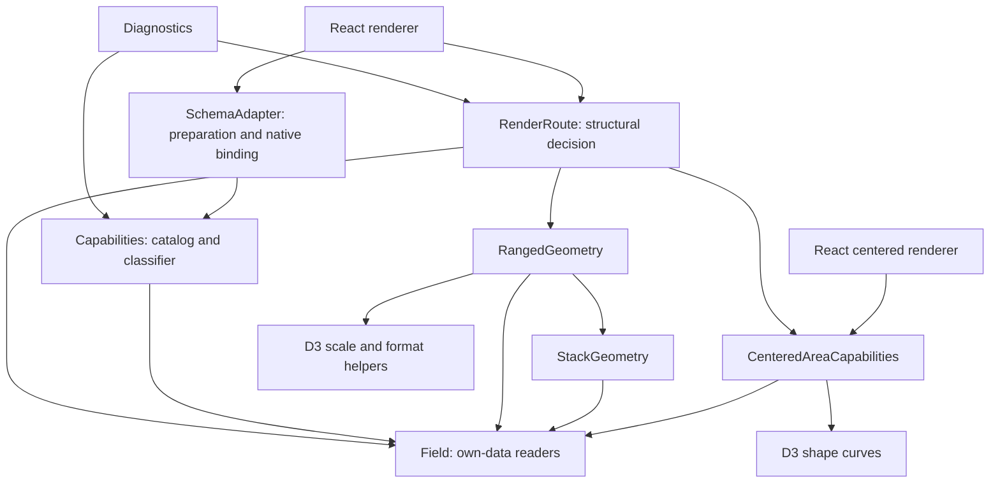

# Vega-Lite semantic fidelity: native Fluent contract

**Source snapshot:** current main-workspace implementation, including the 2026-10-24 medium-finding closures in section 10; not a published-version guarantee. Sections 6–9 retain dated historical validation results. Fresh final combined gates remain pending in section 10; source/test inspection is not a new full-package certification.

**Grammar reference:** Vega-Lite **6.5.0**; statistical/calendar references use tagged Vega **6.4.0**.

**Scope:** A substantial, tested P0–P2 subset of the [historical proposal](vega-lite-support-proposal.md), not completion of its entire backlog.

`VegaDeclarativeChart` interprets a supported Vega-Lite subset and renders native Fluent charts. It does **not** run the official compiler/runtime, switch to it on failure, or support raw Vega. A `$schema` URL, permissive TypeScript property, recognized mark name, or empty diagnostic list is **not** a certificate of full v5/v6 compatibility. Data semantics, view expansion, and actual renderer capabilities are separate gates. Fluent theming and scheme/color remapping are intentional differences, not exact Vega palette/typography equivalence.

## 1. Public boundary and strict versus legacy

Use imports from `@fluentui/react-charts`. The [package index](../../packages/charts/react-charts/library/src/index.ts) reaches the [Vega export surface](../../packages/charts/react-charts/library/src/components/VegaDeclarativeChart/index.ts). The [generated API report](../../packages/charts/react-charts/library/etc/react-charts.api.md) includes both named public resource-option types. API generation and compatibility auditing passed in the dated architecture-review gates below; the report is not still awaiting the original refactor's generation. Fresh final validation of the section 10 changes is separate and remains pending there.

The current source inventory is **197 → 215 root exports: 18 additions, no removed export names**. The **18 additive exports** are:

- Functions: `validateVegaLiteSpec`, `resolveVegaLiteResources`.
- Diagnostics/resources: `VegaLiteDiagnostic`, `VegaLiteDiagnosticOptions`, `VegaDataResolver`, `VegaLiteResourceFormat`, `VegaDataParseOptions`, `VegaLiteResourceOptions`.
- Authoring helpers: `VegaLiteSemanticMode`, `VegaLiteAggregateOp`, `VegaLiteAggregate`, `VegaLiteWindowOp`, `VegaLiteCompositionSpec`, `VegaLiteRepeatSpec`, `VegaLiteRepeatFieldDef`, `VegaLiteRepeatEncoding`, `VegaLiteFacetFieldDef`, `VegaLiteTooltipField`.

Existing `VegaDeclarativeChart`, `VegaDeclarativeChartProps`, `VegaSchema`, and `VegaLiteSpec` remain. Internal transform, view, geometry, and tooltip helpers are **not** additional package exports. The original `HTMLDivElement` ref remains supported through the component's `ForwardRefComponent`/`ForwardRefExoticComponent` intersection. `VegaLiteSpec.repeat` is widened to `string[] | Record<string, unknown>`; repeat-template helpers keep object field references separate from legacy unit `field?: string`. The [local types](../../packages/charts/react-charts/library/src/components/VegaDeclarativeChart/VegaLiteTypes.ts) are deliberately permissive, **not** the full official types: transforms/config/facet remain records and `encoding.tooltip` remains `any`. Representability is not implementation.

The release scope also includes additive public callout hooks on existing `GroupedVerticalBarChartProps`, `HeatMapChartProps`, and `PolarChartProps`, plus `ScatterChartProps.onRenderCalloutPerPoint` for original point identity. These are members of existing public interfaces, not additional top-level exports; the 18-export count does not describe the entire public API change. Legacy Scatter callbacks retain all values at x and null-to-default fallback. New point callbacks hide the surface on null and use native default content on undefined; unbound native heatmap cells retain their missing-data message.

The source resolver now uses the named public `VegaLiteResourceOptions`, extending public `VegaDataParseOptions` in the [resource option types](../../packages/charts/react-charts/library/src/components/VegaDeclarativeChart/VegaLiteResourceLoader.types.ts). Both types are root-barrel exports and remain available through the original loader module. Parse limits do not authorize network access; no default resolver is installed.

| Boundary                                                  | Contract                                                                                                                                                                                                                                                                                                                                                                                                                                                                                                                                                                                                 |
| --------------------------------------------------------- | -------------------------------------------------------------------------------------------------------------------------------------------------------------------------------------------------------------------------------------------------------------------------------------------------------------------------------------------------------------------------------------------------------------------------------------------------------------------------------------------------------------------------------------------------------------------------------------------------------- |
| `semanticMode`                                            | Defaults to `'legacy'`. `'strict'` rejects diagnosed unsupported/malformed declarations before rendering or resource I/O; semantic preparation can also fail later. Strict is opt-in.                                                                                                                                                                                                                                                                                                                                                                                                                    |
| `validateVegaLiteSpec(spec, { mode, allowExternalData })` | Pure bounded preflight returning records with `code`, `path`, `severity`, `message`, and `remedy`; **does not throw to reject a spec**. It checks declarations and safely inspects/parses supported inline formats, but does not execute expressions/transforms, render, log, or load resources. `allowExternalData` acknowledges a host resolver; it does not authorize I/O or check its allowlist.                                                                                                                                                                                                     |
| Diagnostic severity                                       | Strict diagnostics are errors. Unsupported capabilities generally produce warnings in legacy; safety violations and malformed declarations remain errors except for documented compatibility warnings such as invalid numeric tooltip formats. Codes include `unsupported-mark`, `unsupported-channel`, `unsupported-combination`, `unsupported-property`, `unsupported-transform`, `unsupported-aggregate`, `unsupported-window-op`, `unsupported-scale`, `incompatible-shared-scale`, `unsupported-condition`, `invalid-tooltip-filter`, `unsupported-format`, `unresolved-data`, and `unsafe-object`. |
| Component rejection                                       | The [state hook](../../packages/charts/react-charts/library/src/components/VegaDeclarativeChart/useVegaDeclarativeChart.ts), called by the component wrapper, throws strict preflight failures with actionable paths. `unsafe-object`, accessor/callable/cycle/depth/work failures are fatal even in legacy, by diagnostic code rather than English message text. Use an error boundary. Later asynchronous resource failures render `role="alert"`; loading renders a polite `role="status"`.                                                                                                           |
| `onDiagnostics`                                           | A stable event callback uses the latest committed handler. An effect notifies on mount and when the prepared diagnostics array changes, never during render/SSR; callback identity changes or adding a previously absent handler alone do not replay unchanged diagnostics. This is not deep-content deduplication. It cannot report a preflight failure that prevents commit; call `validateVegaLiteSpec` first for that workflow.                                                                                                                                                                      |
| Legacy policy                                             | Retains native fallback/automatic-domain behavior where applicable, while using the improved semantic pipeline. Failed/unknown operations may preserve rows or use compatibility fallback results; warnings must not be treated as faithful output. Budget/safety checks still apply. Legacy is not an unbounded or arbitrary-JavaScript mode.                                                                                                                                                                                                                                                           |

```tsx
import { VegaDeclarativeChart, validateVegaLiteSpec, type VegaLiteSpec } from '@fluentui/react-charts';

const spec: VegaLiteSpec = {
  data: {
    values: [
      { group: 'A', amount: 0 },
      { group: 'A', amount: 4 },
      { group: 'A', amount: null },
      { group: 'A' },
      { group: 'B', amount: 2 },
      { group: 'B', amount: 8 },
    ],
  },
  transform: [
    {
      aggregate: [
        { op: 'sum', field: 'amount', as: 'total' },
        { op: 'median', field: 'amount', as: 'middle' },
        { op: 'valid', field: 'amount', as: 'valid' },
        { op: 'missing', field: 'amount', as: 'missing' },
        { op: 'count', as: 'rows' },
      ],
      groupby: ['group'],
    },
  ],
  mark: 'bar',
  encoding: {
    x: { field: 'group', type: 'nominal' },
    y: { field: 'total', type: 'quantitative' },
    tooltip: [
      { field: 'total', type: 'quantitative', title: 'Sum' },
      { field: 'middle', type: 'quantitative', title: 'Median' },
      { field: 'missing', type: 'quantitative', title: 'Missing' },
    ],
  },
};
// A: total=4, middle=2, valid=2, missing=2, rows=4. Zero is valid.
// B: total=10, middle=5, valid=2, missing=0, rows=2.
const diagnostics = validateVegaLiteSpec(spec, { mode: 'strict' });
// Inspect diagnostics before mounting; a rejecting render cannot commit its callback.
const chart =
  diagnostics.length === 0 ? <VegaDeclarativeChart chartSchema={{ vegaLiteSpec: spec }} semanticMode="strict" /> : null;
```

## 2. Implemented data semantics

The [data engine](../../packages/charts/react-charts/library/src/components/VegaDeclarativeChart/VegaLiteDataTransforms.ts) clones/prepares inputs rather than mutating caller rows/encodings. Own-property field resolution distinguishes nested `stats.amount` from literal `stats\.amount` (write `'stats\\.amount'` in JavaScript), supports bracket paths, and does not read inherited fields/getters/callable values. Generated aggregate/time-unit aliases are collision-aware; private source provenance preserves authored labels and transformed tuples for native adapters/callouts. This is not a reactive Vega dataflow. Strict unknown aggregates/windows and failed filters/calculations fail rather than inventing counts/ranks or silently retaining rows.

| Operation                 | Implemented subset / boundary                                                                                                                                                                                                                                                                                                                                                                                                                                                                                                                                                                                                      |
| ------------------------- | ---------------------------------------------------------------------------------------------------------------------------------------------------------------------------------------------------------------------------------------------------------------------------------------------------------------------------------------------------------------------------------------------------------------------------------------------------------------------------------------------------------------------------------------------------------------------------------------------------------------------------------- |
| Scalar aggregates         | `count`, `sum`, `mean`, `average`, `median`, `min`, `max`, `valid`, `missing`, `distinct`, `values`, `product`, `q1`, `q3`, `variance`, `variancep`, `stdev`, `stdevp`, `stderr`, `argmin`, `argmax`; shared by encoding aggregates, aggregate/joinaggregate transforms, and window frames. Sample/population variants and interpolated quantiles are distinct. `values` returns rows and scalar `argmin`/`argmax` return selected records: these are not numeric position values. Object `{ argmin: field }`/`{ argmax: field }` projection is diagnosed unsupported.                                                             |
| Missing/statistical edges | Null/undefined/empty-string inputs do not become zero observations; actual zero does. Tagged raw-validity/coercion behavior is retained rather than universally discarding every nonnumeric string. Empty/all-missing samples and degenerate fits may yield undefined/nonfinite results or errors; renderer support does not imply all such results are drawable. See the [statistical kernels](../../packages/charts/react-charts/library/src/components/VegaDeclarativeChart/VegaLiteStatistics.ts) and [edge tests](../../packages/charts/react-charts/library/src/components/VegaDeclarativeChart/VegaLiteStatistics.test.ts). |
| Parameterized exponential | Encoding `aggregate: { exponential: b }` and transform `op: { exponentialb: b }`, also shared frame kernels; finite retention `0 <= b <= 1`, input order, valid counts, and group isolation. Bare string names are not substitutes. Names/formulas match **tagged Vega 6.4.0**, not an assumed alternative EMA convention: recurrence retains the previous accumulator by `b`; `exponential` divides the weighted result by `1 - b^n`, `exponentialb` does not. Retention `1` can yield `NaN` for `exponential`; this tested edge is not silently “fixed.”                                                                         |
| Window                    | `row_number`, `rank`, `dense_rank`, `percent_rank`, `cume_dist`, `ntile`, `lag`, `lead`, `first_value`, `last_value`, `nth_value`, plus supported aggregate operations. Grouping, stable multikey sort, integer/null frame bounds, peer expansion/`ignorePeers`, and independent measures; ranking/offset functions retain their frame-independent semantics. Not arbitrary upstream window operations.                                                                                                                                                                                                                            |
| Predicates/expressions    | Restricted string filters/calculations plus field `equal`, `oneOf`, `range`, `valid`, `lt`, `lte`, `gt`, `gte` and logical `and`/`or`/`not`; optional supported time units. Only one native color string `test`/string `value` condition is admitted, not general conditional channels or condition arrays. Parameter/selection predicates are unsupported.                                                                                                                                                                                                                                                                        |
| Calendar                  | Encoding and transform time units; weekday `day` versus day-of-month `date`, compound units, local/UTC flooring, step/binned declarations, invalid values, calendar/DST boundaries. Units compose supported `year`, `quarter`, `month`, `week`, `date`, `day`, `dayofyear`, `hours`, `minutes`, `seconds`, `milliseconds`; incompatible combinations are rejected. Deriving a time unit does not implicitly request a y aggregate.                                                                                                                                                                                                 |
| Reshaping                 | `fold`; `flatten` with aligned arrays/null padding, aliases and optional index; `pivot` with groupby/limit/supported op; `lookup` from inline or already-resolved named/managed secondary records, fields/aliases/defaults or whole-record output; `impute` with groupby, explicit/bounded sequence keys, value/mean/median/min/max methods and frames.                                                                                                                                                                                                                                                                            |
| Numeric transforms        | Standalone `bin` with finite extent/step/nice-bin options and output aliases; `quantile` with groupby/probs/step; `stack` with grouping/sort and zero/center/normalize offsets; `sample` uses a deterministic local reservoir stream seeded internally from input length and sample size, without `Math.random`. No public seed contract or official Vega sample-sequence equivalence is claimed. Native x histograms and pre-binned ranged x/x2 are separate rendering routes, not arbitrary encoding-bin support.                                                                                                                |
| Statistical transforms    | Grouped **linear** regression, aliases, extent, coefficient/r-squared output (`params: true` here means transform output, not interactive chart parameters); robust LOESS with bandwidth/grouping; Gaussian KDE density with bandwidth, counts/cumulative, sampling, extent and shared/independent sampling domains. Tagged numerical/reference cases include empty, repeated-x, singleton and invalid samples, not just smooth finite examples.                                                                                                                                                                                   |

**ISO-week extension, not Vega-Lite 6.5.0 equivalence:** the native engine/preflight additionally recognize compatible `isoweek`, `utcisoweek`, and `yearisoweek` strings. Vega's ISO week calendar is not Sunday-based `week`. The pinned **Vega-Lite 6.5.0 grammar does not admit ISO-week units**; the [corpus manifest](../../packages/charts/react-charts/library/src/components/VegaDeclarativeChart/testing/specs/manifest.ts) explicitly omits them. Native acceptance/extension tests do not make these official-schema-valid specs.

Unsupported: nonlinear regression methods (`log`, `exp`, `pow`, polynomial, etc.), standalone reactive `extent` signal/parameter output, unknown operations, general expressions/registered functions, and parameter-driven transforms. Explicit `extent` options on supported density/linear-regression transforms **are** implemented; they must not be confused with the unsupported standalone transform.

## 3. Views, renderers, and configuration

The [view builder](../../packages/charts/react-charts/library/src/components/VegaDeclarativeChart/VegaLiteViewTree.ts) expands composition before unit renderer selection:

- Named **inline record-array** `datasets` are inherited from ancestors and can be shadowed locally. An explicit child data source replaces inherited rows. Parent transforms run once before child transforms. Lookup sources use the same scoped dataset resolution.
- Recursive `hconcat`, `vconcat`, grid `concat`/`columns`, field or row/column `facet`, and list/row-column `repeat` expand to stable path-scoped cells. Repeat `field: { repeat: 'row' | 'column' | 'repeat' }` bindings are resolved only in specification declarations, not similarly shaped data objects. Layer-repeat and arbitrary official repeat forms are not claimed.
- Facets implement sorted values, supported aggregate sort, simple header title/labels, missing groups and empty Cartesian cells (`No data` regions). Repeat/concat support nested children; composition **inside** a layer is diagnosed unsupported.
- Parent data/encoding and globals (`$schema`, description, dimensions, background, padding, autosize, config, params) are carried into units; config is recursively merged with child overrides. **Carrying a property does not implement it:** background/padding/autosize and chart params remain diagnosed unsupported. Supported config is tooltip defaults at `mark`/mark-type levels plus `numberFormat`/`timeFormat`, not full official config precedence/styling.
- Shared/independent **x/y/color** domains are resolved for compatible field types, including transformed values, both range endpoints, stack extents and explicit domains. Facets default to shared positions; concat/repeat default to independent positions; color defaults shared. A nested independent boundary is not widened by an outer shared scope. Preflight diagnoses exposed shared-field family/scale-type conflicts across composed branches; this does not certify every upstream scale combination. Composed shared legends union exposed series rather than using only the first child's data; independent color scopes use separate color maps. Existing `selectedLegends`/`onSchemaChange` remain native legend interaction, not Vega-Lite selections.

```tsx
import { VegaDeclarativeChart, type VegaLiteRepeatSpec, type VegaLiteSpec } from '@fluentui/react-charts';

const template: VegaLiteRepeatSpec = {
  mark: 'point',
  encoding: {
    x: { field: { repeat: 'column' }, type: 'quantitative' },
    y: { field: { repeat: 'row' }, type: 'quantitative' },
  },
};
const matrix: VegaLiteSpec = {
  datasets: {
    readings: [
      { a: 1, b: 4 },
      { a: 2, b: 8 },
    ],
  },
  data: { name: 'readings' },
  repeat: { row: ['a', 'b'], column: ['a', 'b'] },
  spec: template,
};
const chart = <VegaDeclarativeChart chartSchema={{ vegaLiteSpec: matrix }} semanticMode="strict" />;
```

### Renderer capability, not just recognized grammar

| Route                  | Actual supported boundary                                                                                                                                                                                                                                                                                                                                                                                                                                                                                                                                                                              |
| ---------------------- | ------------------------------------------------------------------------------------------------------------------------------------------------------------------------------------------------------------------------------------------------------------------------------------------------------------------------------------------------------------------------------------------------------------------------------------------------------------------------------------------------------------------------------------------------------------------------------------------------------ |
| Ordinary native charts | Common line/point/circle/square, bar/grouped/stacked/horizontal bar, area, rect heatmap, histogram, arc pie/donut, and supported theta/radius polar combinations through the [schema adapter](../../packages/charts/react-charts/library/src/components/VegaDeclarativeChart/VegaLiteSchemaAdapter.ts). Color/size and position support vary by chart family; shape/detail/opacity/fill/stroke channels being typed does not implement them. Selected layered annotations and bar/line overlays remain partial, not arbitrary layering.                                                                |
| Ranged bar/rect/tick   | Dedicated [geometry predicate/engine](../../packages/charts/react-charts/library/src/components/VegaDeclarativeChart/VegaLiteRangedGeometry.ts) and [renderer](../../packages/charts/react-charts/library/src/components/VegaDeclarativeChart/VegaLiteRangedChart.tsx): primary/secondary endpoints, xOffset/yOffset independent from color, categorical subdivision or linear quantitative displacement, sign/reverse direction, temporal endpoints, tick thickness/size, and supported `cornerRadiusEnd` at the rendered value end. Scales are linear/band/ordinal/time/UTC, not nonlinear geometry. |
| Center bars            | Only predicate-proven bar units with quantitative linear value, discrete category, nominal color field and supported order; horizontal/vertical. No secondary endpoints/offsets/detail. Absolute contributions are stacked with baseline `(maximum absolute group total - this total) / 2`, not centered independently around zero.                                                                                                                                                                                                                                                                    |
| Center areas           | Dedicated [filled-area predicate/renderer](../../packages/charts/react-charts/library/src/components/VegaDeclarativeChart/VegaLiteCenteredArea.tsx): vertical `y.stack: 'center'`, quantitative linear y; quantitative-linear, temporal-time/UTC or ordinal-point/ordinal x; supported nominal/fixed color and order. Observed category/series gaps can be zero-imputed; imputed vertices have no source row and are not interactive. `y.impute: null` disables this. No horizontal center areas, bins, offsets, detail, general color conditions or arbitrary impute configuration.                   |
| P2 geometry layers     | **Flat compatible** bar/rect/tick overlays or **all-center-area** layers, with inherited data/encoding/config, common scale semantics and supported shared axes/legend. Predicate checks gate the actual renderer. Nested/mixed geometry, independently resolved positional scales, incompatible signatures, and independent color/legend scopes are not supported geometry-layer renderers. Do not infer support from the view builder's ability to normalize independent domains.                                                                                                                    |
| Unsupported marks      | Image, geoshape/projection, boxplot, trail, errorbar/errorband; standalone text/rule scenes. A native line/scatter fallback in legacy does not preserve their geometry or uncertainty semantics.                                                                                                                                                                                                                                                                                                                                                                                                       |

**Legacy grouped-bar compatibility is deliberately narrow:** the [renderer selector](../../packages/charts/react-charts/library/src/components/VegaDeclarativeChart/renderVegaDeclarativeChart.tsx) keeps basic vertical bars with nominal/ordinal x, quantitative y and `color.field === xOffset.field` on the existing native grouped renderer in default/explicit legacy mode. The predicate excludes true secondary endpoints, y offsets, horizontal orientation, `cornerRadiusEnd` and center stacking; it also recognizes a compatible single-layer wrapper. Eligible strict-mode grouped bars opt into the new geometry route. True x2/y2 ranges and offsets independent of color remain new geometry in either mode, as do supported centered areas. This preserves the tested legacy route, not a claim of full v8 design-system equivalence or universal grouped-bar compatibility.

### Deliberately narrow axis/style contract and remaining diagnostic gaps

The [preflight allowed-property tables](../../packages/charts/react-charts/library/src/components/VegaDeclarativeChart/VegaLiteDiagnostics.ts) are narrower than the type surface. Axis titles/formats/values/tickCount are mapped where the selected renderer consumes them. `axis.grid` is explicitly unsupported; styled titles/subtitles, legend titles, general axis/config layout and arbitrary mark styles are not supported. Native scales primarily support linear/categorical, x temporal time/UTC and selected y-log combinations; ranged/center geometry additionally handles supported reverse/range/clamp settings. Pow/sqrt/symlog, reactive/union/signal domains and general endpoint-specific scales are not implemented.

Two distinctions must not be hidden behind “strict”:

1. **Heterogeneous shared scales are diagnosed, not unified:** preflight reports `incompatible-shared-scale` for incompatible exposed x/y/color field families and noncategorical scale types in shared composed scopes. Explicit shared conflicts point to `resolve.scale`; implicit shared conflicts point to the conflicting child encoding. Nested independent boundaries remain isolated, nominal/ordinal categorical families can be compatible, and unknown transformed types are not inferred by executing transforms. The builder unions compatible domains; these targeted diagnostics are not universal strict scale conformance.
2. **Axis suppression is renderer-specific:** ranged/center geometry removes the entire suppressed axis group, including baseline paths, ticks and titles; a compatible layer may still supply a visible shared axis. Ordinary native adapters can retain native axes, so preflight now diagnoses unsupported `axis: null` at its authored path: a strict error or legacy warning. Geometry coverage does not promise complete official axis-null layout across chart families.

## 4. Tooltip, privacy, and keyboard/focus contract

The [tooltip projection](../../packages/charts/react-charts/library/src/components/VegaDeclarativeChart/VegaLiteTooltip.tsx) uses the same prepared/source-bound tuples as native/ranged marks, with ordered explicit fields, authored titles, formats, aggregate/time-unit aliases and escaped fields. Explicit projection does **not** fall back to unrequested raw columns. Hover and focus callouts use that projection and matching mark ARIA text; multiline values retain line breaks. Native stacked callbacks are bound to the actual focused/hovered tuple rather than indiscriminately exposing every stack row.

- `tooltip: false` **on a field definition** excludes it from default projected content/ARIA. An explicit tooltip array controls which fields are requested.
- `encoding.tooltip: null`, or supported mark/config tooltip `false`/`null`, disables visual callouts. The disabled path retains a coordinate-only accessible summary, honoring field omission; it does not automatically remove all accessible chart information.
- Mark tooltip precedence is explicit encoding > mark > config[mark type] > config.mark. Supported mark defaults include text and `{ content: 'encoding' | 'data' }`. **`content: 'data'` intentionally exposes own row fields**; callers must not use it for private rows. Tooltip filtering/omission is display policy, not data authorization: sensitive values are still present in supplied data and may affect marks/domains.
- **Legacy compatibility exceptions, not formatter/selection support:** a registered custom `formatType` or invalid numeric format falls back to safe raw text for the selected datum/definition only. A well-formed parameter-only condition is not evaluated; legacy uses the nonconditional field/value fallback when no supported test branch matches, and a conditional-only definition contributes nothing. Preflight still warns at the authored declaration; strict preflight rejects it. Supported test predicates still select their own branch. Tooltip-array filters, `tooltip: false`, explicit projection and source-tuple privacy remain in force; these fallbacks never expose unrelated row fields or execute registered formatters/coercion hooks. Malformed predicates, unsafe accessors and evaluator failures are not swallowed.
- **6.5 field-filter support:** strict preflight and projection support `filter` only on explicit **tooltip-array field definitions**, including fieldless `aggregate: 'count'`. Supported field-bound predicates are `equal`, homogeneous `oneOf`, numeric/DateTime `range` (null open bounds), `valid`, `lt`, `lte`, `gt`, `gte`, and recursive nonempty `and`/`or`/`not`. Each predicate has exactly one operation, no separate `field`/`timeUnit`, expression, selection, parameter or signal. `filter` on a single tooltip object or another encoding channel is rejected as `unsupported-property`; value/datum-only filtered entries are invalid. DateTime bounds are structurally checked, including finite calendar components and boolean `utc`, even on empty data. Runtime comparisons bind to the displayed field/aggregate/time-unit alias, not an arbitrary source singleton. Malformed predicates produce precise `invalid-tooltip-filter` paths. Filtering removes projected tooltip/ARIA fields, **not chart rows**.

```tsx
import { VegaDeclarativeChart, type VegaLiteSpec } from '@fluentui/react-charts';

const tooltipSpec: VegaLiteSpec = {
  data: { values: [{ x: 1, amount: 4, note: 'first line\nsecond line', secret: 'private' }] },
  mark: 'point',
  encoding: {
    x: { field: 'x', type: 'quantitative' },
    y: { field: 'amount', type: 'quantitative' },
    tooltip: [
      { field: 'note', type: 'nominal', title: 'Note' },
      { field: 'amount', type: 'quantitative', format: '.1f', filter: { gte: 3 } },
    ],
  },
};
// Field-bound filter: show Amount only when its own value >= 3; secret is not projected.
// This explicit array predicate is accepted by strict preflight.
const chart = <VegaDeclarativeChart chartSchema={{ vegaLiteSpec: tooltipSpec }} semanticMode="strict" />;
```

The ranged/center renderers share a [chart shell](../../packages/charts/react-charts/library/src/components/VegaDeclarativeChart/VegaLiteChartShell.tsx) for SVG title/description linkage, axes, clipping, legends and the Fluent popover, plus an [interaction hook](../../packages/charts/react-charts/library/src/components/VegaDeclarativeChart/useVegaLiteChartInteraction.ts) for event-owned hover/focus anchors, keyboard navigation and controlled/local legend selection. The extraction reuses the existing root/navigation structure without adding a DOM wrapper; geometry, marks and source-tuple semantics remain renderer-owned. Shared [focus-visible styles](../../packages/charts/react-charts/library/src/components/VegaDeclarativeChart/VegaLiteChartPresentation.styles.ts) use theme-token focus strokes, with centered-point forced-color visibility retained.

Fluent Tabster owns circular arrows, Home/End and non-trapping Tab/Shift+Tab. The hook clears callout anchors on Escape and configures `ignoreDefaultKeydown: { Escape: true }` so Tabster does not refocus the first mark and reopen the dismissed popover. Mixed ranged/center keyboard tests exercise this behavior with actual Tabster navigation and popover surfaces, not only a synthetic Escape handler. Authored accessible labels and linked descriptions are retained; shared tooltip containment avoids duplicate tooltip roles for raw versus semantic content. Native chart keyboard behavior remains chart-family-specific. Empty facets have descriptive regions. These source/tests establish targeted focus/privacy behavior, **not** a completed screen-reader/browser matrix or an Olli-style accessible exploration tree. Point/interval selections, bindings, reactive parameters/domains and animation selections remain **P3, not implemented**.

## 5. Managed resources and safety budgets

No default `fetch`, external resolver, compiler or resource fallback is installed. [Resource loading](../../packages/charts/react-charts/library/src/components/VegaDeclarativeChart/VegaLiteResourceLoader.ts) requires explicit host ownership:

| API                        | Host/resource policy                                                                                                                                                                                                                                                                                                                                                                                    |
| -------------------------- | ------------------------------------------------------------------------------------------------------------------------------------------------------------------------------------------------------------------------------------------------------------------------------------------------------------------------------------------------------------------------------------------------------- |
| Component props            | `dataResolver`, `allowedDataOrigins`, `dataBaseUrl`. Resolver receives `{ url, signal, format }`; canonical HTTP/S URL, no embedded credentials. Absolute resources require an allowlisted origin; relative resources require an HTTP/S base and same-origin relative paths need no extra allowlist.                                                                                                    |
| `resolveVegaLiteResources` | Uses named public `VegaLiteResourceOptions`: `resolveData`, required `signal`, optional `allowedOrigins`, `baseUrl`, and inherited `VegaDataParseOptions` limits. Returns a cloned spec with declared URL sources materialized, including lookup secondary sources and nested templates/layers. Named inline datasets are the view builder's responsibility.                                            |
| Formats/results            | Record arrays, JSON/CSV/TSV text, or own-data `{ values, url }` envelope; JSON `format.property`, number/boolean/date/string parses and D3 `date:`/`utc:` patterns. CSV/TSV quoting/newlines are parsed, not split naively. Invalid declarations/unsupported formats fail. Final response URL metadata is revalidated; equivalent canonical URL/format requests are deduplicated within one resolution. |
| Cancellation/lifecycle     | Abort signals, cancellation racing even uncooperative pending hosts, stale-result rejection, unmount/spec-change cleanup. Host must honor abort to stop its actual I/O. SSR performs no resolver effects; unresolved resources show loading until client resolution. Component preflight checks static view-expansion budget before host I/O.                                                           |

**Redirect/credential responsibility is not delegated away:** revalidating a final URL envelope happens **after** the host's request and cannot undo an unsafe redirect already followed. The host must enforce origins/redirects **before each request**, plus credentials, offline, authentication, SSRF and response-size policy during I/O. Supplying a resolver is not blanket authorization.

The [canonical internal budget module](../../packages/charts/react-charts/library/src/components/VegaDeclarativeChart/VegaLiteBudgets.ts) defines fixed, input-independent allowances. Stage counters are separate, not a pooled allowance or limits that grow with input size. Baseline bounds are safety limits, **not performance measurements or recommended dataset sizes**:

| Stage                        | Default bound                                                                                                                                                                                                                                                                                                                       |
| ---------------------------- | ----------------------------------------------------------------------------------------------------------------------------------------------------------------------------------------------------------------------------------------------------------------------------------------------------------------------------------- |
| Grammar preflight            | 100,000 grammar work units; 64 nesting levels for inspection, including nested row data. Only declared data/dataset/lookup sources enter the separate data counter; an arbitrary grammar property named `values` does not. Large grammar still fails independently of small or empty data.                                          |
| Declared-data inspection     | 100,000 rows per declared source and 40,000,000 cumulative data-inspection work units in either mode. Descriptor copies, parsing, row keys/text, sparse-array slots and semantic scans are charged; cycles, accessors and non-JSON values remain checked. This is not the semantic-operation counter.                               |
| Semantic preparation/copying | 100,000 input/output rows; 1,000 transforms; 200,000 clone-node allowance and clone depth 100; 10,000,000-code-unit individual strings. Each semantic clone has a 40,000,000-work ceiling, and repeated clones share an independent 80,000,000 cumulative copying allowance per semantic context.                                   |
| Semantic operations          | 2,000,000 cumulative charged operations per semantic context, independent of the larger linear-copying allowance. Expensive transforms do not acquire more operations because the input is large. Expression guards remain 10,000 characters/depth 100.                                                                             |
| View expansion               | 10,000 visited views, 64 view levels, 100,000 rows, 10,000,000-code-unit text limit and 80,000,000 cumulative pipeline work, including charged parsing/copies/domain scans; clone depth 128. Expansion products are checked before allocation. This allowance is separate from semantic preparation's copying counter.              |
| Resource parsing/resolution  | 100,000 rows, 10,000,000-code-unit resource text/individual strings, 40,000,000 cumulative charged work per parse call or entire resolution request, and clone depth 128. All resources and repeated copies share the request counter, even with deduplicated host requests. The host still controls bytes received before parsing. |
| Statistical expansion        | Quantile/impute sequence/density sampling declarations have additional 10,000-scale guards; expensive sorting/window/LOESS/KDE work consumes the independent semantic-operation budget.                                                                                                                                             |

**Every applicable limit must pass independently.** Public `VegaDataParseOptions` configures parser/loader `maxRows`, `maxTextLength` and `maxWork`; raising one does not raise the others, preflight's grammar/data counters or later semantic/view limits. It is not a component-wide budget switch or network permission. Wide records, repeated sources, view fanout and cumulative text copies can exhaust work below the row/text caps. Dense and sparse declared sources of **100,001 rows are rejected** in either mode; the 100,000-row bound is not permission for arbitrary transform or view expansion.

The [restricted evaluator](../../packages/charts/react-charts/library/src/components/VegaDeclarativeChart/VegaLiteExpressionEvaluator.ts) does not use `eval`/`new Function` or execute arbitrary expressions, callable data, getters or coercion hooks. Only allowlisted built-ins are callable. The [canonical own-data readers](../../packages/charts/react-charts/library/src/components/VegaDeclarativeChart/VegaLiteField.ts) serve field access, resources, diagnostics, planning and adapters; raw descriptors are deliberately retained only where expressions must reject callables or diagnostics must report unsafe input. Clone cycle/budget policies remain stage-specific. Own-property-safe access and descriptor-based cloning are not permission to pass exotic/proxy objects as an interchange format; use plain data. Safety/work failures are never quietly waived by legacy mode.

Preflight's type-inspection and property/descriptor-inspection catch paths both emit the dedicated **`unsafe-object`** error code for uninspectable/revoked objects. The component's initial and resolved-source checks treat that code as fatal in either mode without matching English message wording. This catches inspection failures; it does not promise safe interchange with arbitrary exotic/proxy objects.

Resource request identity uses the spec, base URL, semantic mode, resolver availability and allowed-origin **set content**, not inline callback/array identity. Inline rerenders do not discard a pending or resolved chart; future host invocations use the latest committed resolver. Change the spec or request policy to reload data. Default component parsing uses the resource limits above; explicit loader callers can supply independent `VegaDataParseOptions` limits, which never grant network permission.

## 6. Source-backed coverage and verified validation snapshot

### Specification corpus

The [corpus test](../../packages/charts/react-charts/library/src/components/VegaDeclarativeChart/VegaLiteSpecificationCorpus.test.tsx) registers **23 real JSON documents**, with pinned grammar/authoring/semantics sources and independently worked expected row matrices in the [manifest](../../packages/charts/react-charts/library/src/components/VegaDeclarativeChart/testing/specs/manifest.ts). All 23 were checked against the **official tagged 6.5.0 grammar** during implementation, including the newly added tooltip-field-filter fixture. The checked-in Jest registration/schema-string checks are not themselves a full official-schema validator invocation on every run. The manifest records `support: 'required'` and grammar/authoring/semantics source tags; the unused `priority` field has been removed. The row-transform `filter` fixture and tooltip-array field-filter fixture exercise different contracts; coverage metadata is not a completion grade.

RED-to-GREEN methodology: independently specified rows/aliases, geometry/order, strict diagnostics, real public renderer/SSR and hover/focus callouts expose incorrect behavior before fixes; rerun the same assertions after implementation. Host layout is modeled; renderer/hooks/validation/transforms are not mocked out. Resource fixtures use an offline resolver and prohibit implicit fetch. Pinned expectations/reference comparisons are not an exhaustive runtime differential execution or a performance benchmark.

| Coverage                                                                                   | Source fixture                                                                                                                                                      |
| ------------------------------------------------------------------------------------------ | ------------------------------------------------------------------------------------------------------------------------------------------------------------------- |
| EMA encoding aliases/counts                                                                | [ema-encoding.vl.json](../../packages/charts/react-charts/library/src/components/VegaDeclarativeChart/testing/specs/ema-encoding.vl.json)                           |
| Tagged exponential variants/missing counts                                                 | [ema-transform-bias.vl.json](../../packages/charts/react-charts/library/src/components/VegaDeclarativeChart/testing/specs/ema-transform-bias.vl.json)               |
| Median/sample/population variance                                                          | [median-variance.vl.json](../../packages/charts/react-charts/library/src/components/VegaDeclarativeChart/testing/specs/median-variance.vl.json)                     |
| Peer ranks/independent cumulative sums                                                     | [window-peers.vl.json](../../packages/charts/react-charts/library/src/components/VegaDeclarativeChart/testing/specs/window-peers.vl.json)                           |
| Trailing frame/ignorePeers                                                                 | [window-ignore-peers.vl.json](../../packages/charts/react-charts/library/src/components/VegaDeclarativeChart/testing/specs/window-ignore-peers.vl.json)             |
| Forward frame/peer endpoints                                                               | [window-forward-frame.vl.json](../../packages/charts/react-charts/library/src/components/VegaDeclarativeChart/testing/specs/window-forward-frame.vl.json)           |
| UTC weekday encoding                                                                       | [utcday-encoding.vl.json](../../packages/charts/react-charts/library/src/components/VegaDeclarativeChart/testing/specs/utcday-encoding.vl.json)                     |
| Local/leap/offset calendar transform                                                       | [yearmonthdate-transform.vl.json](../../packages/charts/react-charts/library/src/components/VegaDeclarativeChart/testing/specs/yearmonthdate-transform.vl.json)     |
| Finite bin boundaries                                                                      | [bin-transform.vl.json](../../packages/charts/react-charts/library/src/components/VegaDeclarativeChart/testing/specs/bin-transform.vl.json)                         |
| Parallel flatten/null padding                                                              | [flatten-parallel.vl.json](../../packages/charts/react-charts/library/src/components/VegaDeclarativeChart/testing/specs/flatten-parallel.vl.json)                   |
| Pivot/literal dotted fields                                                                | [pivot-escaped-field.vl.json](../../packages/charts/react-charts/library/src/components/VegaDeclarativeChart/testing/specs/pivot-escaped-field.vl.json)             |
| Lookup/nested aliases/defaults                                                             | [lookup-inline.vl.json](../../packages/charts/react-charts/library/src/components/VegaDeclarativeChart/testing/specs/lookup-inline.vl.json)                         |
| Normalized stack/order/format                                                              | [normalized-bar-order.vl.json](../../packages/charts/react-charts/library/src/components/VegaDeclarativeChart/testing/specs/normalized-bar-order.vl.json)           |
| Offset field independent of color                                                          | [xoffset-not-color.vl.json](../../packages/charts/react-charts/library/src/components/VegaDeclarativeChart/testing/specs/xoffset-not-color.vl.json)                 |
| Horizontal offset bands                                                                    | [yoffset-named-group.vl.json](../../packages/charts/react-charts/library/src/components/VegaDeclarativeChart/testing/specs/yoffset-named-group.vl.json)             |
| Signed range/end corners                                                                   | [ranged-negative-corners.vl.json](../../packages/charts/react-charts/library/src/components/VegaDeclarativeChart/testing/specs/ranged-negative-corners.vl.json)     |
| Maximum-total centering/order                                                              | [center-bars.vl.json](../../packages/charts/react-charts/library/src/components/VegaDeclarativeChart/testing/specs/center-bars.vl.json)                             |
| Named data/recursive concat/once-only transforms                                           | [recursive-concat-dataset.vl.json](../../packages/charts/react-charts/library/src/components/VegaDeclarativeChart/testing/specs/recursive-concat-dataset.vl.json)   |
| Missing/empty facet cells                                                                  | [facet-missing-cells.vl.json](../../packages/charts/react-charts/library/src/components/VegaDeclarativeChart/testing/specs/facet-missing-cells.vl.json)             |
| Typed repeat bindings                                                                      | [repeat-matrix.vl.json](../../packages/charts/react-charts/library/src/components/VegaDeclarativeChart/testing/specs/repeat-matrix.vl.json)                         |
| Row filtering, explicit private projection/newlines (not tooltip-entry filter grammar)     | [filtered-tooltip-newlines.vl.json](../../packages/charts/react-charts/library/src/components/VegaDeclarativeChart/testing/specs/filtered-tooltip-newlines.vl.json) |
| Strict tooltip-array field filters; zero/null/invalid-value projection without row removal | [tooltip-field-filter.vl.json](../../packages/charts/react-charts/library/src/components/VegaDeclarativeChart/testing/specs/tooltip-field-filter.vl.json)           |
| Offline managed resource                                                                   | [managed-resource.vl.json](../../packages/charts/react-charts/library/src/components/VegaDeclarativeChart/testing/specs/managed-resource.vl.json)                   |

**Tooltip field-filter visual/focus spot-check case (not a recorded screenshot gate):** render that fixture in strict mode and inspect each point by hover and focus. All three finite plot points remain; requested projection and mark ARIA are:

| Point       | Bound filters                                                           | Expected callout / mark ARIA            |
| ----------- | ----------------------------------------------------------------------- | --------------------------------------- |
| 1: zero     | `value: 0` fails `not equal 0`; nonnumeric forecast fails `valid: true` | `Note: zero`                            |
| 2: missing  | `value: null` passes `not equal 0`; null forecast fails `valid: true`   | `Note: missing; value: null`            |
| 3: positive | `value: 5` passes `not equal 0`; `forecast: 7` passes `valid: true`     | `Note: positive; value: 5; forecast: 7` |

Zero is a valid observation; the separate equality predicate intentionally omits it. The fixture uses null and a nonnumeric string, **not `NaN`**, which is not portable JSON. It does not expose `secret` or the omitted positional fields. The [public tooltip-filter integration tests](../../packages/charts/react-charts/library/src/components/VegaDeclarativeChart/VegaLiteTooltipFilterIntegration.test.tsx) verify actual hover/focus callouts and mark ARIA for both tooltip fixtures, retain every plotted row, and check prepared aggregate/time-unit aliases separately.

Additional source evidence: [diagnostic tests](../../packages/charts/react-charts/library/src/components/VegaDeclarativeChart/VegaLiteDiagnostics.test.ts), [transform tests](../../packages/charts/react-charts/library/src/components/VegaDeclarativeChart/VegaLiteDataTransforms.test.ts), [view tests](../../packages/charts/react-charts/library/src/components/VegaDeclarativeChart/VegaLiteViewTree.test.ts), [resource tests](../../packages/charts/react-charts/library/src/components/VegaDeclarativeChart/VegaLiteResourceLoader.test.ts), [semantic adapter tests](../../packages/charts/react-charts/library/src/components/VegaDeclarativeChart/VegaLiteSemanticAdapter.test.ts), [tooltip tests](../../packages/charts/react-charts/library/src/components/VegaDeclarativeChart/VegaLiteTooltip.test.tsx), [ranged focus/geometry tests](../../packages/charts/react-charts/library/src/components/VegaDeclarativeChart/VegaLiteRangedChart.test.tsx), [center-area tests](../../packages/charts/react-charts/library/src/components/VegaDeclarativeChart/VegaLiteCenteredArea.test.tsx), and [public semantic integration tests](../../packages/charts/react-charts/library/src/components/VegaDeclarativeChart/VegaDeclarativeChartSemantic.test.tsx). The [existing Storybook explorer](../../packages/charts/react-charts/stories/src/VegaDeclarativeChart/VegaDeclarativeChartDefault.stories.tsx) and [semantic examples](../../packages/charts/react-charts/stories/src/VegaDeclarativeChart/VegaDeclarativeChartSemantics.stories.tsx) are illustrative, not a strict conformance corpus. `FilteredMultilineTooltips` demonstrates a row filter, not the new tooltip-entry filter fixture.

### Historical recorded implementation gates — 2026-10-11

The results below record the **2026-10-11 implementation before the architecture refactor**, after the tooltip/shared-scale/geometry changes and restoration of locked dependencies. They are not post-refactor results. Local logs/reports are unversioned evidence, not linked release artifacts; fresh 2026-10-12 aggregate/API/build results are recorded in section 7 below. The recorded dependency-inclusive build was **not green**.

| Gate                              | Verified result / qualification                                                                                                                                                                                                                                                                                                                                                                                                                                         |
| --------------------------------- | ----------------------------------------------------------------------------------------------------------------------------------------------------------------------------------------------------------------------------------------------------------------------------------------------------------------------------------------------------------------------------------------------------------------------------------------------------------------------- |
| Vega-focused Jest                 | **1,507 passed, 0 failed; 29 snapshots passed**, without snapshot-update flags.                                                                                                                                                                                                                                                                                                                                                                                         |
| Package type check                | **Passed** production and test configurations with **`--skipSync --excludeTaskDependencies`**. This does not certify dependency builds or export-map synchronization.                                                                                                                                                                                                                                                                                                   |
| Package lint                      | **`--quiet` passed**, with `--skipSync`; not a claim of zero warnings.                                                                                                                                                                                                                                                                                                                                                                                                  |
| Generated API                     | **Passed on 2026-10-11** `react-charts:generate-api` with dependency tasks excluded/skipSync. **197 → 213 exported declarations: 16 additions; no removed exports or existing interface/class members**. This historical report predates the two named public option types; the post-refactor generated report contains 215 declarations.                                                                                                                               |
| Full package Jest                 | **2,351 passed, 0 failed, 84 skipped; 321 snapshots passed**. The earlier [Gauge rerender test](../../packages/charts/react-charts/library/src/components/GaugeChart/GaugeChart.test.tsx) icon snapshot mismatch is **resolved** after `yarn install --immutable` restored the locked icons **2.0.341** instead of the previously installed **2.0.311**. No manifests/lockfile changed, and no Gauge source or snapshot assertions were weakened to obtain this result. |
| Live scoped package build         | **Passed in the original workspace**, using `yarn nx run-many --target=build --projects=react-charts --excludeTaskDependencies --skipSync --skip-nx-cache` and existing dependency artifacts. This verifies the package build, not a clean dependency-chain build.                                                                                                                                                                                                      |
| Emitted JavaScript syntax         | **418 emitted JavaScript files passed syntax checks**, across ESM and CommonJS output. Syntax checks are not runtime/browser validation.                                                                                                                                                                                                                                                                                                                                |
| Build with dependencies           | **Not green** after locked dependency restoration: **26 of 27 dependency tasks succeeded**; unchanged baseline `react-overflow:build` failed API extraction with `Internal Error: Unable to analyze the export "useOverflow_unstable"`. The live scoped chart build does not waive this blocker.                                                                                                                                                                        |
| Tooltip/shared-scale diagnostics  | **396 passed, 0 failed**; replaces the earlier focused 375-test record.                                                                                                                                                                                                                                                                                                                                                                                                 |
| Specification corpus              | **124 passed, 0 failed**, covering all **23** registered fixtures checked against the pinned official **6.5.0** grammar.                                                                                                                                                                                                                                                                                                                                                |
| Public tooltip-filter integration | **7 passed, 0 failed**: both fixtures' row retention, actual hover/focus callouts and ARIA, plus prepared aggregate/time-unit alias filtering. Not a screenshot/browser/screen-reader gate.                                                                                                                                                                                                                                                                             |

Focused results overlap the historical aggregate and must not be added to it. In particular, the 2,351-test full-package result is not post-refactor validation. The Storybook examples and shared normalized-stack browser URL are not a recorded screenshot/visual gate.

**Open release/coverage work:** repair/complete the dependency build; expand official-runtime comparisons and browser/visual/screen-reader coverage; measure transform/render time and incremental bundle cost. Strict tooltip-array filters, targeted heterogeneous shared-scale diagnostics, and ordinary-native axis-null diagnostics are implemented, not universal strict conformance. No benchmark, full arbitrary-Vega/Vega-Lite compatibility, P3 interaction implementation, or blanket P0–P2 completion is claimed.

## 7. Architecture review — 2026-10-12

Source-backed changes address the review findings without changing the P0 feature scope or claiming complete modularization:

1. **Component responsibilities:** the [24-line wrapper](../../packages/charts/react-charts/library/src/components/VegaDeclarativeChart/VegaDeclarativeChart.tsx) delegates to [types/slots](../../packages/charts/react-charts/library/src/components/VegaDeclarativeChart/VegaDeclarativeChart.types.ts), the state hook, [styles](../../packages/charts/react-charts/library/src/components/VegaDeclarativeChart/useVegaDeclarativeChartStyles.styles.ts), and [rendering](../../packages/charts/react-charts/library/src/components/VegaDeclarativeChart/renderVegaDeclarativeChart.tsx). A separate [pure view planner](../../packages/charts/react-charts/library/src/components/VegaDeclarativeChart/VegaDeclarativeChartView.ts) produces presentation copies. Plans/native transformations are memoized, responsive factories have stable module identity, and each native unit owns an independent imperative ref. Interaction callbacks remain current rather than being captured in cached chart props.
2. **Internal presentation state:** `hideLegend` belongs to the internal plan, not caller `_hideLegend` properties. Shared child-legend suppression and independent legends use explicit plan options. Exact `sourceSpec` provenance is captured before copying; metadata restoration leaves caller specs and prepared trees unchanged. The [architecture regressions](../../packages/charts/react-charts/library/src/components/VegaDeclarativeChart/VegaDeclarativeChartArchitecture.test.tsx) check frozen inputs, provenance identity, raw caller flags, refs, memoization, callbacks and resource lifecycle. This fixes copy/provenance handling, not a demonstrated WeakMap memory leak.
3. **Lower-level foundations:** [field resolution](../../packages/charts/react-charts/library/src/components/VegaDeclarativeChart/VegaLiteField.ts) and [data types](../../packages/charts/react-charts/library/src/components/VegaDeclarativeChart/VegaLiteData.types.ts) no longer require importing the transform engine merely for field access or types. Resource parsing, geometry and diagnostics use the canonical resolver; original helper/type re-exports remain. Tooltip still intentionally imports aggregate/predicate operations. Original unit `field?: string` contracts remain unchanged; typed repeat references stay in optional authoring helpers. Type-only edges do not introduce runtime cycles.
4. **Shared accessible presentation:** ranged/center rendering uses Fluent Tabster navigation and the [shared presentation module](../../packages/charts/react-charts/library/src/components/VegaDeclarativeChart/VegaLiteChartPresentation.tsx) for axes, names/descriptions and single-role tooltip containment. Named numeric constants are **SVG user-space geometry**, not CSS typography/spacing. Typography, colors and CSS spacing use theme tokens; CSS-variable token strings are not parsed as geometry numbers.
5. **Explicit headings:** the owning composed view passes `hideTitle`; heading suppression no longer depends on a parent-DOM-query effect. Duplicate headings are absent even in SSR, while authored subtitles, SVG accessible names, generic root props, refs and viewport dimensions remain. Ranged/center and architecture tests cover these contracts.
6. **Public compatibility:** both named resource-option types are root exports; [public API tests](../../packages/charts/react-charts/library/src/components/VegaDeclarativeChart/VegaLitePublicApi.test.ts) cover root/direct imports, exact callback/result types and limits without granting network permission. The wrapper retains original direct-file type re-exports, root class/style/ref behavior and legacy defaults. Existing native chart implementations still include legacy `React.FC`/function-component signatures; new Vega wrappers do not copy that pattern. No sibling component-package dependencies were introduced, and manifests/lockfile are unchanged.

### Post-review verification — 2026-10-12

These results were captured after the architecture refactor and formatting. Commands ran through Nx with `--skipSync --skip-nx-cache`; type checks, API generation and the scoped build excluded dependency tasks. The final test run used `TZ=UTC` and no snapshot-update flag.

| Gate                            | Verified result / qualification                                                                                                                                                                                                                                                                                                                                                                                                                     |
| ------------------------------- | --------------------------------------------------------------------------------------------------------------------------------------------------------------------------------------------------------------------------------------------------------------------------------------------------------------------------------------------------------------------------------------------------------------------------------------------------- |
| Full package Jest               | **42 suites passed, 1 existing suite skipped; 2,442 tests passed, 0 failed, 84 existing skips; 321 snapshots passed with no updates**. Counts come from the final Jest JSON report, not sums of overlapping focused runs. The same test counts passed again in the 2026-10-12 precommit run after the latest presentation edits, along with library/story types and lint, API generation, scoped build, Beachball validation and whitespace checks. |
| Library and story type checks   | **Both passed**. Excluded dependency tasks; not a dependency-build certification.                                                                                                                                                                                                                                                                                                                                                                   |
| Library and story lint          | **Both `--quiet` runs passed**; not a zero-warning claim.                                                                                                                                                                                                                                                                                                                                                                                           |
| Generated API and compatibility | **Generation passed**. A TypeScript AST audit of HEAD versus the generated report confirms **197 → 215 declarations: 18 additions, no removed exports or interface/class members, and no optional members made required**. The original component ref intersection and direct-file type exports remain.                                                                                                                                             |
| New module formatting           | **All 12 new architecture/foundation/presentation files match repository Prettier formatting**, accounting for existing CRLF.                                                                                                                                                                                                                                                                                                                       |
| Scoped package build            | **Passed** with existing dependency artifacts and dependency tasks excluded. The earlier unchanged `react-overflow` API-extraction failure still blocks the dependency-inclusive build; it was not repaired or waived by this review.                                                                                                                                                                                                               |
| Release metadata and whitespace | **Beachball validation and `git diff --check HEAD` passed**. The minor chart change entry is retained; manifests and lockfile are unchanged.                                                                                                                                                                                                                                                                                                        |

Only the reviewed grouped-bar snapshot changed in this refactor: Tabster navigation markup, SVG description linkage and keyboard instructions. Its baseline was regenerated in complete test-file order to retain stable React ID sequencing; the subsequent full run above passed without updating snapshots. Review-only task entries and untracked test reports were removed, preserving the original four editor tasks and Nx caches. These implementation changes were subsequently committed and published in draft PR #36872.

Focused field/diagnostic (**51**), public API (**6**), architecture (**12**), ranged (**150**) and centered-area (**65**) cases are included in the aggregate where applicable; they must not be added to the full-package count. Browser screenshots, screen-reader checks and measured performance/bundle cost remain unverified.

**Modularity risks recorded on 2026-10-12:** the transform engine was roughly 2,000 lines, the adapter roughly 4,000, and diagnostics retained large tested capability tables/classifiers. At that review, a generated capability registry was a possible future improvement, not an implemented feature. Section 10 subsequently introduces a private canonical native-kind/binding catalog and shared structural routing, not a generated universal capability registry or complete operator extraction. Clone implementations deliberately remain separate: the semantic clone can preserve cyclic row graphs, whereas resource cloning rejects cycles and applies different depth/text/work policies. Consolidation must preserve those safety contracts, not blindly unify security checks. No performance, bundle-size or complete design-system migration claim follows from this refactor.

### PR review follow-up — 2026-10-16

Review fixes restore legacy Scatter all-values/null-fallback behavior and add an original-point callback rather than changing existing APIs. Newly added callbacks distinguish null suppression from undefined fallback, including native-generated missing heatmap cells. Resource lifecycle tests cover inline callbacks/origin arrays and controlled legend focus. Separate data/grammar budgets retain hostile-input checks while validating 20,000/50,000-row inputs; a default legacy integration test renders 19,999 native segments from 20,000 rows. Resource parsing tests reach the 10M text boundary under the finite 40M work allowance. Canonical own-data readers preserve explicit callable rejection and unsafe-input diagnostics. Empty tooltip arrays/filters retain ranged accessible names. The CI URL-literal lint suppression is attached to the literal, not the enclosing test.

Combined local validation: **42 suites passed, 1 existing suite skipped; 2,531 tests passed, 84 existing skips; 321 snapshots passed without updates**. Library/story type checks and full `lint --quiet`, API generation, scoped chart build, Beachball validation and whitespace checks passed with the same Nx dependency exclusions documented above. No browser/screen-reader or dependency-inclusive build success is inferred. The earlier screenshot check failed while downloading Cypress (`ENOTFOUND download.cypress.io`), independently of the source lint failure; fresh remote CI is still required after publication.

## 8. Review follow-up — 2026-10-20

The source and test assertions cover seven additional review changes. Fresh aggregate validation is recorded below; the 2026-10-16 counts above remain historical and unchanged.

1. **Canonical independent budgets and full-size pipeline evidence:** diagnostics, resources, semantic preparation and views now import the [budget constants](../../packages/charts/react-charts/library/src/components/VegaDeclarativeChart/VegaLiteBudgets.ts); the stage/configuration table in section 5 supersedes the former 2M data-inspection/view allowances. The earlier [public legacy integration baseline](../../packages/charts/react-charts/library/src/components/VegaDeclarativeChart/VegaDeclarativeChartSemantic.test.tsx) is a real frozen 20,000-row render with 19,999 native line segments, not a mock. New [transform/preparation tests](../../packages/charts/react-charts/library/src/components/VegaDeclarativeChart/VegaLiteDataTransforms.test.ts) exercise actual 100,000 four-field rows, cloning and sampling in both modes. The [full pipeline tests](../../packages/charts/react-charts/library/src/components/VegaDeclarativeChart/VegaLiteViewTree.test.ts) cover **four combinations: inline/resolved data × legacy/strict**, with preflight, explicit scalar parsing, a calculate transform, view expansion/domain inference, planning and the actual native line adapter. Assertions retain **100,000 native adapter points**, including the final tuple and unchanged source data; managed resolution uses an offline host. Separate [diagnostic safety tests](../../packages/charts/react-charts/library/src/components/VegaDeclarativeChart/VegaLiteDiagnostics.test.ts) and preparation/view tests reject over-limit sources, including 100,001 rows. This is complete source-verified preparation-to-adapter coverage for those cases, **not a 100,000-mark DOM render, timing benchmark or general large-data performance guarantee**.
2. **Deterministic local reservoir and independent SSR:** the [sampler](../../packages/charts/react-charts/library/src/components/VegaDeclarativeChart/VegaLiteDataTransforms.ts) uses a local Mulberry32 stream derived from row count/sample size and Algorithm R replacement with bounded rejection sampling, not global `Math.random`, input serialization or an authored seed. Tests assert independent builds select the same positions without invoking getters/coercion hooks. The [architecture SSR regression](../../packages/charts/react-charts/library/src/components/VegaDeclarativeChart/VegaDeclarativeChartArchitecture.test.tsx) independently server-renders a frozen 100-row ranged spec sampled to **7 marks**, compares markup after normalizing only generated IDs/references, and checks tuple labels and finite paths. It inspects server markup, **not actual client hydration**. No public seed/output-sequence contract, official Vega sample-sequence equivalence or browser hydration certification follows.
3. **Narrow legacy tooltip fallbacks with privacy intact:** [tooltip tests](../../packages/charts/react-charts/library/src/components/VegaDeclarativeChart/VegaLiteTooltip.test.tsx) and [public hover/focus integration tests](../../packages/charts/react-charts/library/src/components/VegaDeclarativeChart/VegaLiteTooltipFilterIntegration.test.tsx) assert selected raw-value text for custom/invalid numeric formatting and nonconditional fallback for unresolved parameter conditions. Native line/bar and ranged/centered cases retain mark ARIA, declaration warnings, filters and field exclusions; the same declarations reject in strict preflight. They do not implement registered formatters, parameter selections or unrequested data fallback.
4. **Legacy grouped routing, strict geometry opt-in:** [actual-renderer architecture cases](../../packages/charts/react-charts/library/src/components/VegaDeclarativeChart/VegaDeclarativeChartArchitecture.test.tsx) cover titled/untitled region and budget representatives on the native grouped route for default/explicit legacy mode, versus predicate-proven geometry in strict mode. True endpoints and independent offsets stay geometry in all modes. These targeted compatibility assertions are not a full gallery/browser or v8 design-system certification.
5. **Shared shell and interaction ownership:** the [shell](../../packages/charts/react-charts/library/src/components/VegaDeclarativeChart/VegaLiteChartShell.tsx), [interaction hook](../../packages/charts/react-charts/library/src/components/VegaDeclarativeChart/useVegaLiteChartInteraction.ts) and shared focus-visible styles consolidate framing, event anchors, keyboard handling and legend selection without another DOM wrapper or merging geometry semantics. [Mixed ranged/center keyboard cases](../../packages/charts/react-charts/library/src/components/VegaDeclarativeChart/VegaLiteRangedChart.test.tsx) use real Tabster navigation/popover surfaces in both chart orders: Escape leaves focus on the current mark and closes the surface without reopening it; arrows resume navigation and Tab/Shift+Tab leave the group. Layout visibility is modeled in JSDOM. [Centered-area tests](../../packages/charts/react-charts/library/src/components/VegaDeclarativeChart/VegaLiteCenteredArea.test.tsx) also assert focused-callout restoration after hover and token-based focus-visible/forced-color styles, not a completed browser/screen-reader matrix.
6. **Stable post-commit diagnostics delivery:** the [state hook](../../packages/charts/react-charts/library/src/components/VegaDeclarativeChart/useVegaDeclarativeChart.ts) uses a stable event callback for the latest committed `onDiagnostics`; its effect follows mount/prepared-array changes, not handler identity. [Architecture regressions](../../packages/charts/react-charts/library/src/components/VegaDeclarativeChart/VegaDeclarativeChartArchitecture.test.tsx) cover an inline handler updating parent state without a notification loop, replacement handlers receiving future diagnostics only, late handler attachment without replay, legend/parent rerenders and no SSR delivery. An unchanged diagnostics array is not replayed merely because a callback becomes available.
7. **Unsafe objects rejected by code:** both type-inspection and property/descriptor-inspection catch paths in [preflight](../../packages/charts/react-charts/library/src/components/VegaDeclarativeChart/VegaLiteDiagnostics.ts) emit `unsafe-object`. Diagnostic tests cover throwing traps at root/grammar/row paths, revoked proxies and array-length descriptor failures without ordinary property reads. The component's safety-code set applies before preparation and after resource resolution; architecture tests rewrite diagnostic messages and still assert fatal rejection in legacy/strict. Safety is not classified by matching English error text.

### Verified follow-up gates — 2026-10-20

Results below come from the final complete run and JSON report, not sums of overlapping focused results. The grouped-bar snapshot was reviewed and restored to native legacy output; eleven later snapshot changes are generated-ID sequencing only. The baseline was regenerated in complete test-file order before this clean full-package run without update flags. Validation used `TZ=UTC` and the same Nx skip-sync/cache and dependency exclusions documented above.

| Gate                                                                          | Current qualification                                                                                                                                                                                                   |
| ----------------------------------------------------------------------------- | ----------------------------------------------------------------------------------------------------------------------------------------------------------------------------------------------------------------------- |
| Full package Jest                                                             | **42 suites passed, 1 existing suite skipped; 2,632 tests passed, 0 failed, 84 existing skips; 321 snapshots passed, 0 updated**.                                                                                       |
| Library/story types and lint                                                  | **Both type checks and both full `lint --quiet` runs passed**; not a zero-warning claim.                                                                                                                                |
| Generated API/compatibility, scoped build, release metadata and whitespace    | **API generation passed with no report delta**; no public APIs removed or widened by these changes. **Scoped chart build, Beachball and whitespace checks passed**. The scoped build excludes dependency certification. |
| Dependency-inclusive build and remote CI                                      | No fresh success recorded; the earlier dependency-build blocker is not waived by local/scoped results. Fresh remote CI remains required.                                                                                |
| Browser hydration, visual/screen-reader coverage, performance and bundle cost | **Not certified**. Independent SSR markup and JSDOM keyboard assertions do not establish actual hydration, a browser matrix, 100,000-mark DOM performance or measured incremental bundle cost.                          |

## 9. Independent design review — 2026-10-23

**Review basis:** the 2026-10-23 main-workspace source and test assertions, including the resolved grouped-bar merge implementation, rather than an earlier detached review snapshot. The inspected Vega and grouped-bar source/test files contained no conflict markers. This is an independent assessment of responsibility boundaries, Fluent alignment, compatibility and future extension work. Its dated validation evidence is retained below; the later medium-finding closures and pending final verification are in section 10.

### Scope and design alignment

The file surface spans implementation modules, adjacent regression tests, raw specification fixtures, expected matrices, snapshots, stories, public declarations and documentation. File volume alone does not measure architectural complexity: fixtures and tests are evidence, not additional runtime layers. The **historical 2026-10-23 scope audit** against `upstream/master`, before staging the two new internal semantic-error files, counted **100 tracked feature files: 39 implementation, 24 tests/snapshots, 31 fixtures, 2 story files and 4 documentation/release/API files**. Adding the error module/test brought that inspected scope to **102 files (40 implementation, 25 tests/snapshots)**, including 62 supporting tests/fixtures/stories/docs files rather than runtime implementation. These dated, mutually exclusive path-based counts are retained unchanged; they are not a current inventory after the section 10 additions, bundle-size measurements or test counts. Unrelated files from the 59-commit upstream integration are not Vega feature scope.

1. **The wrapper has the appropriate v9 boundary.** The [component](../../packages/charts/react-charts/library/src/components/VegaDeclarativeChart/VegaDeclarativeChart.tsx) delegates to state, styles and rendering, uses `ForwardRefComponent`/`React.forwardRef`, and preserves its existing `HTMLDivElement` ref intersection and direct-file type exports. The [state/types contract](../../packages/charts/react-charts/library/src/components/VegaDeclarativeChart/VegaDeclarativeChart.types.ts) has a root slot and discriminated unit/composition plans. The [state hook](../../packages/charts/react-charts/library/src/components/VegaDeclarativeChart/useVegaDeclarativeChart.ts) owns preparation, request identity and committed callbacks; the [planner](../../packages/charts/react-charts/library/src/components/VegaDeclarativeChart/VegaDeclarativeChartView.ts) owns presentation copies and legend scopes. This follows the repository's [component pattern](component-patterns.md) without widening the public prop surface to arbitrary root attributes or renderer plugins.
2. **Semantic foundations are distinct from execution and host I/O.** [Own-data/field readers](../../packages/charts/react-charts/library/src/components/VegaDeclarativeChart/VegaLiteField.ts), [data types](../../packages/charts/react-charts/library/src/components/VegaDeclarativeChart/VegaLiteData.types.ts), [budget constants](../../packages/charts/react-charts/library/src/components/VegaDeclarativeChart/VegaLiteBudgets.ts) and the internal error module provide small reusable foundations. [Diagnostics](../../packages/charts/react-charts/library/src/components/VegaDeclarativeChart/VegaLiteDiagnostics.ts) inspect declarations and supported inline formats without executing the [transform pipeline](../../packages/charts/react-charts/library/src/components/VegaDeclarativeChart/VegaLiteDataTransforms.ts) or requesting resources. They reuse renderer capability predicates; this is not a claim that their dependency graph contains only grammar/type modules. [View expansion](../../packages/charts/react-charts/library/src/components/VegaDeclarativeChart/VegaLiteViewTree.ts) and [resource resolution](../../packages/charts/react-charts/library/src/components/VegaDeclarativeChart/VegaLiteResourceLoader.ts) retain their separate responsibilities.
3. **Rendering has private, intentional extension seams.** The [renderer map and route selection](../../packages/charts/react-charts/library/src/components/VegaDeclarativeChart/renderVegaDeclarativeChart.tsx) pair native adapters with module-stable responsive renderers. Predicate-proven ranged/centered geometry is selected separately, with a narrow legacy grouped-bar exception. This is an internal registry, not a public registration API. A private map is appropriate for the current closed supported subset; making it public would introduce capability, typing, safety and compatibility contracts that this feature does not require. Native adapters retain author-facing encoding operations, while geometry receives prepared specs; those inputs must not be collapsed into one interchangeable representation.
4. **Shared presentation follows Fluent ownership rather than DOM inference.** The [shell](../../packages/charts/react-charts/library/src/components/VegaDeclarativeChart/VegaLiteChartShell.tsx) shares framing, axes, legends and the popover, while the [interaction hook](../../packages/charts/react-charts/library/src/components/VegaDeclarativeChart/useVegaLiteChartInteraction.ts) owns event anchors, Tabster navigation and legend selection. Geometry and tuple semantics remain renderer-owned. [Presentation styles](../../packages/charts/react-charts/library/src/components/VegaDeclarativeChart/VegaLiteChartPresentation.styles.ts) and [composition styles](../../packages/charts/react-charts/library/src/components/VegaDeclarativeChart/useVegaDeclarativeChartStyles.styles.ts) use theme tokens. The numeric [SVG presentation constants](../../packages/charts/react-charts/library/src/components/VegaDeclarativeChart/VegaLiteChartPresentation.tsx) describe plot-space geometry, not CSS font or spacing values; converting them to parsed CSS-variable strings would be incorrect. This is targeted alignment with the [token rules](design-tokens.md), not certification of every legacy native chart style.
5. **Provenance is necessary, not evidence of a leak.** View-source and [adapter tuple bindings](../../packages/charts/react-charts/library/src/components/VegaDeclarativeChart/VegaLiteSchemaAdapter.ts) use `WeakMap` metadata; the planner captures exact source identity before making presentation copies. No demonstrated memory leak follows from those weak-key maps. The resolved [grouped-bar implementation](../../packages/charts/react-charts/library/src/components/GroupedVerticalBarChart/GroupedVerticalBarChart.tsx) retains collision-safe, null-prototype `barPointsByLegend` storage alongside original-point/group callback maps. Its [merge regressions](../../packages/charts/react-charts/library/src/components/GroupedVerticalBarChart/GroupedVerticalBarChart.test.tsx) assert repeated-bar identities, special category/legend names, mixed and line-only categories, aggregate callout values and secondary-line metadata. These are source-backed assertions, not a claim that the pending full run has passed them.
6. **Lifecycle and SSR scope remain appropriate.** Resource effects obtain the document through Fluent context, create an abort controller only after commit, cancel on cleanup and reject stale results by request identity. Loader cancellation can reject an uncooperative pending host, but cannot itself stop that host's actual I/O; redirect/credential/response-size policy remains host-owned. The retained legacy depth-15 guard runs before resource effects and rejects deeper input: it is a compatibility restriction, not evidence of a critical post-I/O depth gap. SSR and JSDOM assertions do not establish actual browser hydration, screen-reader behavior or large-mark rendering performance.

### Findings and disposition

- **Historical medium — message-based foreign budget classification: CLOSED 2026-10-24.** The 2026-10-23 review found that evaluator/statistics errors still crossed a message-matching bridge despite typed transform errors. The [producer-level closure in section 10](#typed-budget-errors-at-their-producers) replaces that classification with canonical `SemanticError` instances and preserves their identity through catches. `withLegacyVegaBudgetErrors` remains only as a deprecated transparent wrapper, with no internal production call sites or message regex. Untyped foreign errors still default to `INVALID`; this is not a promise to recognize future external or exotic failures as budgets.
- **Historical medium — cross-file extension coordination: CLOSED 2026-10-24.** The 2026-10-23 review identified separately maintained native IDs, binding dispatch and renderer/diagnostic route decisions. The [canonical catalog and shared-route closure in section 10](#canonical-native-kinds-and-spec-dependent-routing) adds compile-time coordination and cross-boundary fixtures without a public plugin API. Geometry constraints remain in pure predicates; substantial adapter/operator modules and future extension review remain maintainability debt, not risks eliminated by a universal registry.
- **Low — shell accessibility, title ownership and corpus metadata corrections are present.** The shell names one SVG `role="group"` and leaves its root `role="presentation"`; authored `aria-labelledby` takes naming precedence while an authored `aria-label` is retained. Caller description IDs are deduplicated in order and merged with the generated description. [Ranged regressions](../../packages/charts/react-charts/library/src/components/VegaDeclarativeChart/VegaLiteRangedChart.test.tsx) and [centered-area regressions](../../packages/charts/react-charts/library/src/components/VegaDeclarativeChart/VegaLiteCenteredArea.test.tsx) assert these contracts, root props/ref preservation and title suppression. `hideTitle` explicitly omits the visible heading, including SSR; ancestor selectors/effects are unnecessary, and removing CSS-based suppression is not a lost requirement. The [manifest](../../packages/charts/react-charts/library/src/components/VegaDeclarativeChart/testing/specs/manifest.ts) and [corpus registration test](../../packages/charts/react-charts/library/src/components/VegaDeclarativeChart/VegaLiteSpecificationCorpus.test.tsx) no longer carry the unused priority field/assertions; section 6 now reflects that source.
- **Low — large modules remain extraction candidates.** The adapter and transform dispatcher are still substantial review hotspots. [Statistical kernels](../../packages/charts/react-charts/library/src/components/VegaDeclarativeChart/VegaLiteStatistics.ts) are already separate; recommending their first extraction would be obsolete. Future work should extract one operator/family behind a private typed contract at a time, preserving dispatch, numerical edge cases, provenance and budget charging. Separate clones are intentional: semantic preparation can preserve cyclic row graphs, while resource/view clones reject cycles and have different depth/work policies. Blind clone consolidation would risk changing safety behavior.
- **Compatibility constraint — do not fold native API modernization into this change.** Existing published native charts still include legacy signatures such as the grouped chart's `React.FC` annotation despite using `React.forwardRef`. That does not justify copying the pattern into new wrappers, nor does it justify an incidental public ref/type conversion here. Keep existing callbacks and consumer ref contracts; the [Scatter tests](../../packages/charts/react-charts/library/src/components/ScatterChart/ScatterChart.test.tsx) distinguish legacy all-values/null-fallback behavior from the additive original-point callback. Any future native signature modernization needs its own compatibility review.

### Minimal extension checklist

This guidance reflects the section 10 closures; it is not additional supported functionality or a completed release gate:

1. **New native kind:** add its binding entry to `nativeTooltipBinding`, the canonical catalog from which `VegaNativeChartKind` is derived. The typed native renderer map then requires a transformer/renderer pair; a new binding strategy must satisfy the adapter's exhaustive `never` check. Update classification while retaining the `getChartType` preparation/type-correction facade. Add an independently enumerated fixture covering the kind, real transformer/renderer dispatch, original-tuple binding, callout and ARIA behavior, not just a map-key assertion.
2. **New mark or rendering combination:** add semantic mark/channel metadata and an acceptance/rejection fixture even if an existing native kind can classify it. Classifier fallback is not semantic admission. Shape, range, scale and composition constraints belong in the pure geometry predicates, not a giant catalog or static native-kind-to-geometry map. Exercise the shared route with prepared versus native-source provenance, default/explicit legacy and strict modes, inherited bare layer marks, composed scales/legends and a real public renderer. Preserve the narrow native grouped-bar exception and renderer-specific axis diagnostics; do not merely widen authoring types.
3. **New transform or aggregate:** add dispatch/validation and diagnostics together; use canonical own-field readers and the existing cumulative context. Throw explicit semantic error codes at owned producers, preserve typed instances through catches, and never infer budget policy from message text or a foreign object's `code` property. Charge copying and expensive operations to their independent counters and preserve source/alias metadata. Add independently calculated numerical cases, empty/missing/invalid inputs, ordering/grouping, strict/legacy policy and resource/preparation integration where applicable.
4. **Shared presentation or interaction:** retain one named SVG, authored label precedence, deduplicated descriptions, explicit heading ownership, token styling, focus/hover tuple identity, Escape dismissal and non-trapping Tab behavior. Test both ranged and centered consumers rather than assuming shell reuse proves all interaction paths.
5. **Public compatibility:** keep helpers and registries private unless a consumer contract is deliberately proposed. If published types, callbacks or exports change, review the generated API and include the package's consolidated Beachball entry; do not infer public export changes from internal module exports.

### Verification boundaries and conclusion

Resource parsing does **not** reset its work allowance for every source: one resolution creates a budget and passes it through `parseResource`, spec copies, all resolved sources and repeated materialization copies. Independent grammar, semantic-operation, copying and view budgets need not have identical numeric limits; each bounds different work and must pass independently. These source facts rebut a per-resource-reset or numeric-mismatch finding, not prove measured throughput.

**Historical merged-tree validation — 2026-10-23:** **45 suites passed, 1 existing suite skipped; 2,730 tests passed, 0 failed, 84 existing skips; 321 snapshots passed without updates**. Library and story type checks, both full `lint --quiet` runs, API generation and the scoped chart build passed. The grouped-bar merge retained both upstream special-name/category regressions and PR callout identity/metadata cases. These results predate the section 10 changes; no focused results are summed into the aggregate.

The dependency-inclusive build is **not green** in this workspace: unchanged `react-overflow:build` API extraction again reports `Unable to analyze the export "useOverflow_unstable"`; the umbrella component build then also sees missing `OverflowReorderObserver` in dependency declarations. Existing dependency artifacts allow chart/story checks, not a clean dependency-build certification. **Beachball validation passed after the master merge commit**; the earlier pre-commit comparison had included upstream release-deleted change files. Browser/visual/screen-reader coverage, actual hydration, performance and incremental bundle cost remain uncertified here. No new public exports, plugin API or native ref-signature conversions were introduced by the design improvements.

**Assessment, updated for section 10:** the design has appropriate v9 wrapper/state/render separation and usable private extension seams for the supported native subset. Both medium implementation findings are closed as described below, not all architectural or release risks. Remaining priorities are final combined verification, explicit review of future capability changes, and incremental operator/adapter extraction where a concrete change benefits. The retained bridge no longer classifies errors. A new public plugin system, blanket clone unification, native API rewrite or claim of complete Vega-Lite conformance is not warranted by this review.

## 10. Medium-finding closures — 2026-10-24

**Status:** both section 9 medium implementation findings are **CLOSED 2026-10-24**, with the completed combined validation gates recorded below. No new public barrel exports, renderer-plugin API or native ref-signature conversion accompanies these internal changes.

### Canonical native kinds and spec-dependent routing

The private [capability module](../../packages/charts/react-charts/library/src/components/VegaDeclarativeChart/VegaLiteCapabilities.ts) now owns three distinct concerns, without React, preparation or transform execution:

- `nativeTooltipBinding` is the canonical catalog of **11 native kinds** and their point-container binding strategies. `VegaNativeChartKind` is its key union; `ChartTypeResult.type` uses that union. The [renderer map](../../packages/charts/react-charts/library/src/components/VegaDeclarativeChart/renderVegaDeclarativeChart.tsx) must satisfy `Record<VegaNativeChartKind, ...>` while retaining its heterogeneous transformer/renderer signatures. The existing JSX dispatch boundary is not a new universally typed plugin interface.
- `vegaSemanticMarkChannels` preserves the diagnostic mark/channel metadata, including annotation-only rule/text exceptions. It does not admit unsupported marks merely because native fallback classification can return a line/scatter kind.
- `classifyPreparedVegaChart` preserves classifier branch priority for an already prepared, type-corrected spec. The [adapter's `getChartType` facade](../../packages/charts/react-charts/library/src/components/VegaDeclarativeChart/VegaLiteSchemaAdapter.ts) still calls `prepareAdapterSpec`, then `autoCorrectEncodingTypes`, then that classifier. The pure classifier is not a replacement for preparation and is not used by diagnostics or structural routing.

Native tooltip attachment consumes the catalog through an exhaustive strategy switch with a `never` guard. It retains actual point/stack/group/scatter callback behavior and original tuple identity rather than assigning one generic callout to every chart family.

The shared [route module](../../packages/charts/react-charts/library/src/components/VegaDeclarativeChart/VegaLiteRenderRoute.ts) owns `getVegaRenderRoute(preparedSpec, nativeSourceSpec, mode = 'legacy')`, returning `native`, `ranged` or `centered-area`. The route is spec-dependent, not a fixed property of a native kind: ordinary area remains native, supported center area uses its geometry, and polar is not center-area geometry. Centered-area capability is tried first, then ranged capability subject to the narrow legacy grouped-bar exception.

Rendering supplies the prepared geometry spec separately from the native source that retains author-facing encoding operations and compatibility metadata. The native source controls the legacy grouped exception; projected aliases/inferred types must not replace it. Eligible same-color/xOffset grouped bars remain native in default/explicit legacy, including typed, supported untyped and single inherited-layer forms; strict opts into predicate-proven geometry. True endpoints and independent offsets remain geometry in either mode. The selected geometry route is carried through the responsive wrapper rather than recomputed there or leaked onto the DOM.

[Diagnostics](../../packages/charts/react-charts/library/src/components/VegaDeclarativeChart/VegaLiteDiagnostics.ts) call the same route with their safe inherited declaration snapshot for both spec arguments. They do **not** prepare data, execute transforms or invoke native classification; inherited bare layer marks remain supported. Structural ranged-layer admission is kept separate from the actual mode-aware geometry route. Consequently, an eligible legacy grouped bar with `axis: null` now receives an `unsupported-property` warning at the authored/inherited encoding path, because the actual native renderer does not suppress that axis. The strict geometry equivalent remains valid. This closes route/diagnostic drift for that case without promising universal axis suppression.

The centered predicate and its shared mark/unit/order/curve helpers now live in the React-free [centered-area capability module](../../packages/charts/react-charts/library/src/components/VegaDeclarativeChart/VegaLiteCenteredAreaCapabilities.ts). The [original centered renderer module](../../packages/charts/react-charts/library/src/components/VegaDeclarativeChart/VegaLiteCenteredArea.tsx) re-exports the same predicate for direct-module compatibility; the predicate is not duplicated or added to the public barrel. Shape/range constraints remain in these pure predicates rather than being flattened into a giant metadata registry.

### Focused module graph

The relevant direct runtime edges below distinguish metadata, structural routing and React presentation; this is not a complete dependency/bundle audit. Type-only `VegaLiteTypes` edges are omitted. The renderer also consumes `VegaNativeChartKind` as a type-only edge to the catalog.



The route branch imports neither React nor the semantic transform engine: ranged geometry depends on D3 scale/format helpers, field readers and the field-only stack helper; centered capability depends on field readers and D3 curves. This does not claim that the adapter or every transitive diagnostics dependency is React-free. Predicate reuse is structural admission, not semantic execution or full Vega support.

### Typed budget errors at their producers

The internal [error module](../../packages/charts/react-charts/library/src/components/VegaDeclarativeChart/VegaLiteSemanticError.ts) keeps explicit `WORKBUDGET`, `UNSUPPORTED` and `INVALID` policy. `toSemanticError` preserves an actual `SemanticError` instance, including its code and identity; an untyped error defaults to `INVALID`. The [transform catch policy](../../packages/charts/react-charts/library/src/components/VegaDeclarativeChart/VegaLiteDataTransforms.ts) rethrows canonical `WORKBUDGET` in legacy as well as strict, without examining its message.

Owned lower-level guards now throw the canonical type at their producer:

- **[Restricted evaluator](../../packages/charts/react-charts/library/src/components/VegaDeclarativeChart/VegaLiteExpressionEvaluator.ts):** 10,000-character source guard, 10,000-token guard and parser nesting depth 100; array conversion has cumulative 100,000-slot work and depth 100 guards. Existing evaluator message text is retained through the internal `preserveMessage` option.
- **[Statistical kernels](../../packages/charts/react-charts/library/src/components/VegaDeclarativeChart/VegaLiteStatistics.ts):** density `steps`, `minsteps` and `maxsteps` above 10,000 throw `WORKBUDGET`; canonical failures from the supplied cumulative `spend` callback propagate unchanged through LOESS/KDE.
- **[Semantic pipeline](../../packages/charts/react-charts/library/src/components/VegaDeclarativeChart/VegaLiteDataTransforms.ts):** existing clone, copying, depth/row/expansion and cumulative semantic-operation guards retain explicit typed budget failures and the independent stage allowances documented in section 5.
- **[Resource parsing](../../packages/charts/react-charts/library/src/components/VegaDeclarativeChart/VegaLiteResourceLoader.ts):** work, row, text and depth exhaustion throw canonical `WORKBUDGET`, preserving their existing messages. Invalid budget configuration is `INVALID`, not exhaustion. The diagnostics parse boundary checks the canonical class and code rather than `/limit|budget/` message matching. Malformed/security failures, host errors and cancellation `AbortError` retain their existing non-budget behavior; this is not blanket error normalization.

`withLegacyVegaBudgetErrors` is retained only as a **deprecated transparent compatibility wrapper** whose implementation is `return run()`. It contains no regex, performs no error conversion, and has no internal production call sites; the direct uses left in source are compatibility tests. Removing its old classification does not change all errors into budgets: an ordinary error mentioning `limit`/`work budget`, or a foreign object/error carrying a spoofed `code: 'WORKBUDGET'`, is not a canonical instance and still defaults to `INVALID`. Existing legacy fallback versus strict rejection for those ordinary failures is preserved. Future owned producers must throw the canonical type; no guarantee is made to identify arbitrary future external/exotic failures, bypass plain-data requirements, or turn off any guard.

[Error invariants](../../packages/charts/react-charts/library/src/components/VegaDeclarativeChart/VegaLiteSemanticError.test.ts), [evaluator guards](../../packages/charts/react-charts/library/src/components/VegaDeclarativeChart/VegaLiteExpressionEvaluator.test.ts), [statistical regressions](../../packages/charts/react-charts/library/src/components/VegaDeclarativeChart/VegaLiteStatistics.test.ts) and [pipeline catches](../../packages/charts/react-charts/library/src/components/VegaDeclarativeChart/VegaLiteDataTransforms.test.ts) cover actual canonical failures, including rewriting `.message` to `stop` and asserting that the **same instance** remains fatal with `WORKBUDGET` in both modes. Unknown operations/identifiers containing `limit`, invalid pivot limits and misleading untyped errors retain their ordinary classification. Neither the error type nor the wrapper is a package-root export.

The [resource-loader tests](../../packages/charts/react-charts/library/src/components/VegaDeclarativeChart/VegaLiteResourceLoader.test.ts) and [diagnostics tests](../../packages/charts/react-charts/library/src/components/VegaDeclarativeChart/VegaLiteDiagnostics.test.ts) additionally cover genuine exhaustion, renamed canonical errors, spoofed/plain misleading errors, invalid configuration and the actual 100,001-row JSON-text parse boundary. These regressions were observed failing before the producer/catch fix and passing afterward.

### Completed combined verification

Focused implementation evidence includes **69 passing new capability/routing cases** (37 capability cases and 32 route cases), a **375-passing focused typed-error regression run**, and **45 new resource/diagnostic cases**. [Capability fixtures](../../packages/charts/react-charts/library/src/components/VegaDeclarativeChart/VegaLiteCapabilities.test.ts) enumerate all 11 native kinds, frozen classifier priorities, real transformers/native renderers and binding metadata; [route fixtures](../../packages/charts/react-charts/library/src/components/VegaDeclarativeChart/VegaLiteRenderRoute.test.ts) cover provenance, inherited bare marks, no-heavy-preflight behavior, legacy/strict axis diagnostics and actual geometry/native output. These scoped reports overlap the final package run and are **not additive totals**.

- **Combined/full-package Jest — passed:** 2,875 tests, zero failures, 84 existing skips; 47 suites passed and one skipped; all 321 snapshots matched, zero updated. This completed UTC run includes the parser-boundary follow-up; the section 9 2,730-test result remains historical.
- **Library/story type checks and lint — passed** through Nx. Lint used `--quiet` (errors enforced, warnings suppressed), not a claim of zero warnings.
- **Generated API/compatibility, scoped build, Beachball and whitespace — passed.** Generated public API has no diff; the conservative declaration/member compatibility check against `7751831edabecacf32723308cef0d7c5ff1f1a17` passed. The chart-only build and type/API checks used existing dependency artifacts with task dependencies excluded.
- **Dependency-inclusive build and remote CI — no new success claimed.** Earlier blockers/qualifications are retained until a fresh completed gate supersedes them.
- **Browser/visual/screen-reader matrix, actual hydration, performance and incremental bundle cost — not certified.** Structural/typed-error closure and focused renderer tests are not performance measurements or blanket Vega/Vega-Lite support.

**Remaining debt:** large adapter/operator dispatchers still merit incremental private extraction with numerical, provenance and work-accounting regressions. Clone policies remain intentionally stage-specific: semantic preparation can preserve cyclic row graphs, while resource/view clones reject cycles with different depth/text/work policies. Neither this catalog nor typed producer errors justifies blanket clone consolidation, removal of compatibility behavior or a claim that all architectural risks are gone.

## 11. Review follow-up — 2026-11-04

Five new inline review requests were reproduced and addressed:

- **Typed native callback fallback:** the new HeatMap/Polar point callbacks and grouped-bar point/stack callbacks explicitly return `JSXElement | null | undefined`. Their existing optional data and `defaultRender` parameters are preserved; the global `RenderFunction` contract and existing APIs are unchanged. Existing runtime fallback tests now infer `undefined` instead of hiding the type mismatch with `any`; these produced four TypeScript errors before the declaration fix. The generated API report changes only those four callback signatures. The conservative compatibility checker intentionally flags existing signature edits; these exact four additive return widenings were inspected, not silently allowed by weakening that checker.
- **Continuous values are not categories:** the [view planner](../../packages/charts/react-charts/library/src/components/VegaDeclarativeChart/VegaDeclarativeChartView.ts) excludes quantitative/temporal color encodings from composed categorical legend unions. Native heatmap cells continue using their continuous ramps; no new continuous legend is claimed.
- **Geometry/shared-legend parity:** composed ranged/centered swatches use domain indices, including absent categories and `scale.reverse`, matching mark fills rather than borrowing native cache insertion order. Public renderer tests cover authored, inherited, inferred and layered domains with reversed/nonreversed palettes and hidden child legends. Native color-map/provenance behavior is retained.
- **Unsupported continuous ranged color:** [capability checking](../../packages/charts/react-charts/library/src/components/VegaDeclarativeChart/VegaLiteRangedGeometry.ts) rejects continuous field color for single as well as layered ranged geometry. Strict preflight reports `unsupported-color` at the authored/inherited color path; legacy warns and uses its approximate native fallback. Quantitative/temporal fields and explicitly continuous field scales are not silently treated as categorical indices. This is bounded rejection, not newly implemented color interpolation. Categorical/static geometry colors and native continuous heatmaps remain supported.
- **Excluded fields stay excluded in ARIA:** the [ranged renderer](../../packages/charts/react-charts/library/src/components/VegaDeclarativeChart/VegaLiteRangedChart.tsx) uses a nullish fallback for the wrapper's accessible projection. An intentionally empty projection gets `Data point`, not geometry coordinates, offsets or series labels. Partial projections retain only selected fields. Unit, inherited-layer and concatenated public output is tested in legacy and strict modes, including focus/hover tooltip suppression.

Regression coverage lives in the adjacent native tests plus [view/legend tests](../../packages/charts/react-charts/library/src/components/VegaDeclarativeChart/VegaDeclarativeChartView.test.tsx), [continuous-color tests](../../packages/charts/react-charts/library/src/components/VegaDeclarativeChart/VegaLiteContinuousColor.test.tsx), [public ARIA tests](../../packages/charts/react-charts/library/src/components/VegaDeclarativeChart/VegaLiteRangedAccessibility.test.tsx) and existing ranged/diagnostic tests. Red/green failures were observed for callback typing, legend mapping, unsupported color admission and ARIA leakage before their fixes.

**Combined local validation:** 2,997 tests passed, zero failed, 84 existing skips; 50 suites passed and one skipped; all 321 snapshots matched without updates. Library/story type checks and lint, generated API consistency, chart-only build, Beachball and whitespace passed. The four expected API edits require the manual compatibility qualification above. Scoped build/type/API checks exclude dependency tasks and use existing artifacts; this is not a dependency-inclusive build or browser/screen-reader certification.

**Hourly runner repair:** the scheduled action had stopped before model invocation because it hardcoded an obsolete Nx CLI path, despite successful immutable installation. The local controller now resolves the installed package's declared `bin.nx` entry. Nineteen controller checks cover both CLI layouts, paths with spaces, argument boundaries, missing binaries and existing publication guards. This fixes that tooling failure without claiming the separately documented dependency-build/API Extractor blocker is resolved. No unverified visual report is automatically considered addressed by these chart fixes.

## 12. Real Storybook and image verification — 2026-11-10

The owner's deployed Docs report exposed a missing verification layer: the earlier Jest/type results did **not** prove actual Storybook rendering. Eight semantic exports were indexed, but missing full-source metadata broke their Docs previews in the sandbox decorator; the 23 JSON corpus fixtures were not selectable stories. They are now explicitly indexed alongside Default and the eight semantic stories: **32 stories plus 32 Docs previews**. Each corpus story loads the original JSON, presents independently worked expectations and provides a runnable public-API sample. Story-local metadata is checked against the normative test manifest; the production SWC exclusion of test-only TypeScript is not bypassed.

The [browser verifier](../../packages/charts/react-charts/stories/scripts/verify-vega-stories.cjs) runs through the noncached `react-charts-stories:test-browser:vega` Nx target against an already-running per-package Storybook. It validates the actual index, real DOM/paint bounds, source/addon availability, finite plot sizing, hand-worked projected values and geometry, category/domain order, exact seeded colors, visible markers, tooltip privacy, keyboard-operated controls and real hover/focus. Each run retains original PNGs, per-story JSON and a summary; partial/filtered runs cannot report complete acceptance. Browser-free negative controls reject missing previews, invisible errors, wrong bin baselines, palette substitutions, invisible markers, reordered categories/legends, clipped text/shadows and missing source.

### Defects found beyond unit tests

- Native bar/scatter adapters now preserve numeric dimensions and a finite default height, eliminating the measured self-growing responsive loop. Authored standalone native titles are visible without duplicating composed/geometry headings.
- The semantic tooltip control authors `encoding.tooltip: null`, not an invalid boolean; host-failure controls remount only the chart when explicitly changed. Default's editor uses shrinkable token-styled tracks rather than overflowing its Field.
- Binned quantitative x/x2 plus quantitative y defaults to a vertical zero-baseline bar; x2 alone no longer incorrectly implies horizontal orientation. The real three-bin fixture must paint frequency-two rectangles, not thin strips centered at two.
- Scatter honors static/field/mark color precedence, categorical domain mapping, bounded linear continuous palettes and explicit legend suppression. This shared-stop interpolation is not the full upstream scheme runtime; native size-area ranges and size legends remain unsupported.
- Authored `point: true` enables visible native line markers per unit. The last visible marker no longer loses pointer input to the transparent magnetic latch; line-only paths retain their enlarged hover area.
- Category, stack and color-domain orders remain independent. Normalized bars retain April–May–June order and stable domain legends while stack order changes; absent legend categories are not fabricated data segments, and misleading normalized totals of `1` are hidden.
- Shared Cartesian child arrays have stable keys preserving existing keys, element identity, refs and callbacks. Full date endpoint ticks retain space inside the native SVG.
- Geometry hosts use natural outer height for real legends while keeping the SVG viewport fixed. The additive optional `ChartPopoverProps.inline` preserves native `true` by default; declarative tooltips opt into the themed portal to escape clipped ancestors. Centered interaction targets render outside the filled-series clip, so endpoint focus indicators remain visible in SVG gutters.

### Evidence and acceptance boundaries

Manual inspection of the first supposedly passing run found incorrect histogram shapes, static scatter colors, category/legend order, invisible line markers and cropped legends/callouts. That run is superseded, not final proof. The stronger real hover then exposed the transparent final-point overlay; a real browser now verifies the visible marker owns the center hit, the exact multiline callout appears on hover/focus in Canvas and Docs, and the original line-only radius-eight latch still works. No force-hover or synthetic mouse dispatch substitutes for that proof.

Snapshot updates are intentional and individually reviewed: finite scatter height, authored categorical palette associations, lines-plus-markers and visible authored headings. Subsequent full runs must match all 321 snapshots without updating them. Generated API adds only optional `ChartPopoverProps.inline`; existing declarations, callbacks and ref signatures remain intact.

**Completed local verification:** 3,159 tests passed, zero failed, 84 existing skips; 60 suites passed and one skipped; all 321 snapshots matched without updates. The unfiltered all-stories-plus-Docs audit passed all 32 stories and 32 Docs previews with zero failures, including final-point real hover/focus, unclipped endpoint focus, visible authored title, controls and source/addon checks. The prospective personal runner recorded identical before/after source hashes (`sourceStable: true`) and runtime versions rather than attributing an older run to a later dirty tree. Scope remains the seeded supported subset described here.

Browser captures use Edge, a 1440×1100 viewport, en-US, UTC, light theme and reduced motion. The immutable [personal verification archive](https://github.com/atisjai_microsoft/personal/tree/main/docs/pr-guidance/fluentui-36872) retains earlier failed/superseded generations and a per-scenario comparison matrix; newer evidence must be appended rather than rewriting the original checkpoint. The [reusable playbook](https://github.com/atisjai_microsoft/personal/blob/main/docs/fluentui-charts-verification.md) distinguishes unit/type checks, actual stories, Docs/source, manual images, upstream oracle and release gates.

Local browser verification is not a claim that the old deployed site has refreshed. A freshly published head still requires its own CI/deployment check. No full upstream Vega runtime oracle, universal grammar conformance, all Default dropdown/remote gallery examples, external sandbox execution, mobile/cross-browser/forced-colors, screen-reader, hydration, performance or dependency-inclusive build certification follows from this work.
