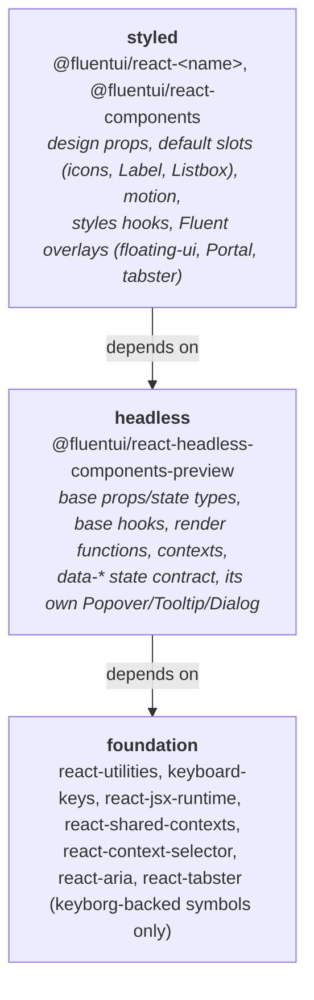
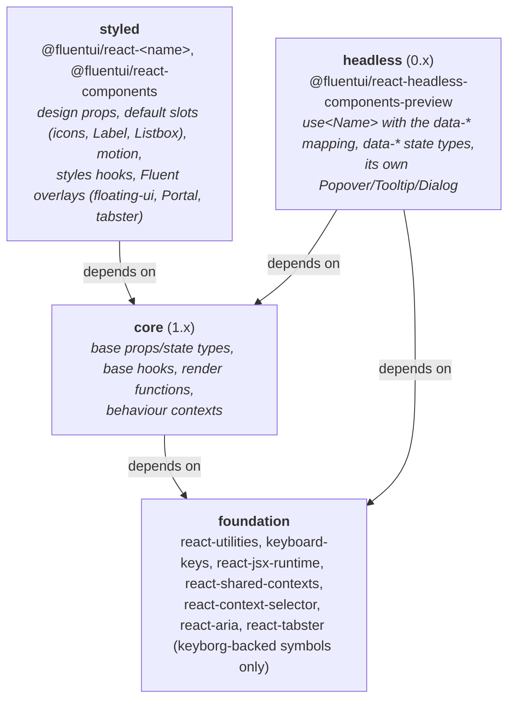

# RFC: Headless-first architecture for Fluent UI React v9

---

_Author: @mainframev_

## Summary

Today the headless layer is built on top of the styled layer: `@fluentui/react-headless-components-preview` depends on
the styled v9 component packages and wraps their `use*Base_unstable` hooks. This RFC turns that around.

1. **The base layer moves out of v9.** The base props and state types, the base hooks, the render functions and the
   compound contexts move into a base package that styled v9 and headless both build on. There are two ways to do
   this (section 1):

   - **Option A**: headless is the base package, and v9 depends on headless.
   - **Option B (proposed)**: a new stable core package is the base package, and v9 and headless both depend on it.
     v9 does not depend on headless.

   Either way, headless ends with no dependency on any `@fluentui/react-<component>` package.

2. **The `data-*` state contract stays in headless.** Styled v9 calls base hooks that emit no `data-*` attributes. No
   headless `data-*` attribute appears in a v9 type, in v9 DOM or in v9 SSR output. In option B the package boundary
   guarantees it; in option A a lint rule does.
3. **Overlays with their own headless implementation stay as they are.** Headless Popover, Tooltip, Dialog and the
   Menu root are independent implementations on top of the HTML Popover API, `<dialog>` and CSS anchor positioning.
   They do not wrap a v9 base hook, so there is nothing to move, and v9 Popover, Tooltip, Dialog and Menu do not
   become dependent on them. Only components whose headless version wraps a v9 base hook move.

This RFC is about the direction of the dependency only. v9 package names, export maps and repository layout do not
change. Aligning the v9 packaging with the headless one (one package, one subpath per component) is a separate
follow-up that this RFC keeps in mind but does not propose; see [Follow-ups](#7-follow-ups-out-of-scope-keep-in-mind).

The migration is a sequence of small steps. Every step ships on the regular v9 train, needs no major version, and
leaves the repository working. Step 4 removes the v9 base hooks in a minor, as a documented exception with its own
gates.

## Background

- [Headless components](./headless-components.md) decided that headless components reuse the v9 hooks and render
  functions and expose state as `data-*` attributes, which are a versioned contract.
- [Base state hooks](./base-state-hooks.md) split every v9 hook into `use<Name>Base_unstable` (logic and accessibility
  only: no styles, no tokens, no motion, no default slot content) and `use<Name>_unstable` (the Fluent defaults on top).
  The split is enforced by the `base-hook-no-forbidden-runtime` lint rule in `tools/eslint-rules` and by the
  `verify-bundle-isolation` target, which the workspace plugin adds to every project that has a
  `bundle-isolation.config.json`.

Both RFCs left the base hooks inside the styled packages. This RFC moves their ownership to the base package and
completes the split.

## Problem statement

1. **The dependency points the wrong way.** `@fluentui/react-headless-components-preview` depends on 43 styled component
   packages: most of its components call a v9 `use<Name>Base_unstable` hook, add `data-*` attributes and re-export the
   v9 render function. Installing headless therefore installs the styled packages together with Griffel, `react-icons`,
   tabster and motion, and the only thing keeping them out of a consumer's bundle is a bundler-level check
   (`verify-bundle-isolation`), not the dependency graph. Styling already leaks into some base hooks through imports
   (`menuItemClassNames` in `useMenuBase_unstable`, the styled `Listbox` as the default listbox in
   `useComboboxBase_unstable`). Every behaviour fix for headless has to land in a v9 package first.

2. **Styled packages depend on each other for behaviour.** `docs/architecture/layers.md` forbids component-to-component
   dependencies, yet the v9 graph is full of them (Field → Label, Checkbox → Field, Avatar → Badge + Popover + Tooltip,
   Nav → Button + Drawer + Tooltip, and so on) and nothing enforces the rule. Each edge is one of two things:

   - a **behaviour** dependency: `react-checkbox` depends on `react-field` only to call
     `useFieldControlProps_unstable`, which reads the Field context and wires `id`, `aria-labelledby`,
     `aria-describedby`, `aria-invalid` and `required` onto the input. Eleven packages have this edge. It is pure
     logic, which is what the base layer is for, and today it can only be expressed as a dependency on a styled
     package.
   - a **rendering** dependency: `react-checkbox` depends on `react-label` to render `Label` as the default `label`
     slot. That is a styled concern and belongs where it is.

   How this RFC addresses it: the behaviour edges disappear from the styled graph because the base hooks move to the
   base package and call its `field` entry there (section 5 and step 2 show Checkbox). What is left between
   styled packages is rendering only, which is easy to audit and, later, easy to consolidate.

## Goals

- No breaking change for any published v9 import, export, type, class name or version range. Headless is a preview
  package; where a move breaks a headless export (Button's context, section 5), the headless changelog says so.
- Everything v9 consumes from the base package (base hooks, render functions, base types, behaviour contexts) follows
  the v9 breaking-change policy from the moment it moves. In option B that is core's own `1.x` policy; in option A it
  applies whatever the headless version number says. The headless hooks and the `data-*` contract keep the preview
  package's own policy.
- No styling runtime reachable from the base package or headless, enforced by the dependency graph and lint, with
  `verify-bundle-isolation` as the end-to-end check rather than the only check.
- The `data-*` state contract stays headless-only. Styled v9 DOM and SSR output does not change.
- Reuse the tooling that exists: `base-hook-no-forbidden-runtime` through its `forbiddenRuntimes` option,
  `@fluentui/no-restricted-imports` from the ESLint plugin, `verify-bundle-isolation`, and the per-subpath
  `generate-api` and `export-maps-sync` already running on the headless project.

Not in scope: visual changes, replacing Griffel or the `use<Name>Styles_unstable` hooks, new components (including
headless entries for table, tree, list and carousel), renaming or stabilising the headless preview package, unifying the
custom headless overlays (Popover, Tooltip, Dialog, the Menu root) or Provider with their v9 counterparts, consolidating
the v9 packages, subpath exports on `@fluentui/react-components`, shim packages, merging the stories projects.

## Proposal

### 1. Two ways to reverse the dependency

Both options move the same code out of v9, keep the `data-*` contract out of v9, follow the same layer rules (section
4), treat overlays the same way (section 6) and use the same migration steps apart from their order. They differ in
where the base layer lives and what v9 depends on.

|                                  | Option A: v9 depends on headless                    | Option B: core package (proposed)          |
| -------------------------------- | --------------------------------------------------- | ------------------------------------------ |
| Base layer lives in              | headless (`0.x`)                                    | core (`1.x`, never takes a major)          |
| v9 depends on                    | headless                                            | core                                       |
| Headless depends on              | foundation                                          | core and foundation                        |
| Packages                         | no new package                                      | one new package                            |
| Duplicate copies of base layer   | likely: a caret on `0.x` only allows patch bumps    | deduped by caret ranges on `1.x`           |
| What keeps `use<Name>` out of v9 | a lint rule                                         | the package boundary                       |
| `data-*` contract can change     | on `0.x`, but every change ships to v9's dependency | on `0.x`, without touching core or v9      |
| Cost                             | v9 depends on a preview package                     | core can only grow; nothing can be removed |

This RFC proposes option B. Option A is described in section 2 because it is the smaller change and the starting
point the review discussion worked from.

### 2. Option A: v9 depends on headless



Headless is the base package. Each headless subpath exports both hooks, `use<Name>Base` and `use<Name>`, and v9
imports `use<Name>Base` from it. Two things follow:

- Every v9 component package depends on a `0.x` preview package. A caret on `0.x` only allows patch bumps, so an app
  that upgrades v9 packages one at a time can end up with two headless copies, which duplicates base hooks and splits
  contexts. A split context fails silently: in
  `<Field label="Email" required validationState="error"><LibraryInput /></Field>`, Field provides on one copy, the
  input reads `undefined` from the other and loses `id`, `aria-labelledby`, `required` and the validation state. A
  duplicated `react-field` breaks this the same way today; the `0.x` range makes duplicates far more likely and
  affects every behaviour context at once.
- TypeScript accepts `use<Name>` wherever the base state is expected, so only a lint rule (step 0) stops a v9 hook
  from calling it and putting the `data-*` attributes into v9 DOM.

### 3. Option B (proposed): stable core package



The part both layers share goes into a third package that starts at `1.x` and never takes a major bump. The two-hook
split from section 5 decides what goes where:

- **core**: `use<Name>Base`, `<Name>BaseState`, `render<Name>` and the behaviour contexts. No `data-*` attributes.
- **headless**: `use<Name>` (base hook plus the `data-*` mapping), `<Name>State` with the `data-*` fields, the
  `data-*` contract, and the custom overlays from section 6. Headless re-exports `use<Name>Base` and `render<Name>`
  from core, so headless consumers keep one import path.
- **v9**: design props, default slots, styles hooks and Fluent overlays. It depends on core, not on headless.

```ts
// core (1.x)
export const useButtonBase = (props: ButtonProps, ref): ButtonBaseState => {
  /* behaviour and accessibility, no data-* */
};
export const renderButton = (state: ButtonBaseState) => {
  /* ... */
};

// headless (0.x)
import { useButtonBase, type ButtonBaseState } from '<core>';

export type ButtonState = ButtonBaseState & { root: { 'data-disabled'?: string /* ... */ } };

export const useButton = (props: ButtonProps, ref): ButtonState => {
  const state: ButtonState = useButtonBase(props, ref);
  state.root['data-disabled'] = toDataAttributeValue(state.disabled);
  // ...
  return state;
};

// v9 (9.x)
import { useButtonBase } from '<core>'; // headless is not a dependency, so useButton cannot be imported
```

What this fixes compared with option A:

- v9 no longer depends on a `0.x` package. Caret ranges on `1.x` dedupe, so v9 and headless share one copy of every
  behaviour context.
- v9 cannot import `use<Name>` because headless is not in its dependencies. The package boundary does the job of the
  lint rule.
- Headless can rename or add `data-*` attributes on `0.x` without touching core or v9.

Rules for core:

- Only APIs that have stopped changing go in. The base hooks qualify: they move from v9 as they are and already carry
  the v9 `9.x` no-major promise. Headless-only hooks that are still changing (positioning, focus management) stay in
  headless until they settle.
- The `data-*` mapping stays out of core. Adding it later is an additive change; removing it after it ships would need
  a major. It can move to core once the contract is stable and v9 adopts it (see follow-ups).
- Changes are additive only. A context or base state can gain a field but cannot rename or remove one.

How v9 imports core:

- v9 packages import core from its root entry (`@fluentui/react-core-preview` in the PoC), never from a subpath. API
  Extractor rolls each v9 package's types into one `dist/index.d.ts` and keeps imports from other packages as they
  are, so a subpath import in v9 source ends up in v9's published types. Consumers that resolve with
  `moduleResolution: node` ignore `exports`, cannot find the subpath and lose those types. The repo's own
  `type-check` resolves workspace dependencies from their built `dist` in the same way, so the failure shows up in
  every package downstream of the one that used the subpath.
- A lint rule in each v9 package that depends on core rejects `@fluentui/react-core-preview/*`, so the mistake fails
  where it is made.
- Subpaths stay available for headless consumers. The rule can go once the repo and its supported consumers no longer
  use `moduleResolution: node`: TypeScript 6.0 deprecates it, 7.0 removes it, and the repo's own move to `bundler` is
  tracked in microsoft/fluentui#36409.

Types:

- v9 calls the core hooks and render functions directly, without wrappers or casts. v9 base types such as
  `FieldBaseProps` type the label slot as `Label` and core types it as `<label>`; both directions are assignable,
  because `ComponentState` types every `components` entry as `React.ElementType` and `Label`'s props are a superset of
  `<label>`'s.
- Today's v9 base types describe the label slot as `Label`, but the base hooks have always rendered a `<label>`.
  They keep that typing until Step 4 removes them; core has the accurate types.

Open question: the package name.

### 4. Layer rules

These hold in both options. "Base package" is core in option B and headless in option A.

- The base package and headless import foundation only (in option B, headless also imports core). Neither imports
  `@griffel/*`, `@fluentui/react-theme` at runtime, `react-icons`, `react-motion*`, `react-portal`, the `tabster`
  runtime, or a styled package. `react-positioning` stays as it is today: headless takes types and
  `resolvePositioningShorthand` from it for its own CSS anchor `usePositioning`. In v9, `usePositioning` is called in
  `useTagPicker_unstable` (an outer hook), in `useMenuBase_unstable` (the Menu root, which headless does not wrap;
  headless Menu has its own root `useMenu`), and in `useComboboxBase_unstable` and `useDropdownBase_unstable` through
  `useComboboxPositioning`. Headless Combobox and Dropdown do not call those two base hooks; they position the listbox
  with their own `useListboxPopupState`. Step 1 moves the positioning call out of the two v9 base hooks before they
  move. What happens to the `react-positioning` dependency is decided by the
  headless positioning strategy RFC (#36807), not here. `react-aria` and `react-tabster` are foundation: the base
  layer takes `useActiveDescendant` and `ActiveDescendantContextProvider` (Combobox, Dropdown, TagPicker),
  `AriaLiveAnnouncer` (Toaster), `useARIAButtonProps` (PopoverTrigger), `useIsNavigatingWithKeyboard` and
  `KEYBORG_FOCUSIN` from them, and every one of those symbols bottoms out in keyborg or plain DOM. The `tabster`
  runtime is forbidden at the symbol level, which is what `base-hook-no-forbidden-runtime` and
  `verify-bundle-isolation` already check today.
- Styled imports the base package and foundation. When a styled package needs another component's behaviour it
  imports the base package's `field` entry, never another styled package.
- A styled package may still depend on another styled package to render it as a default slot (Checkbox renders `Label`,
  Avatar renders `Badge`). That is a rendering dependency, it stays explicit in `package.json`, and it never reaches a
  base hook.

### 5. What each layer owns, per component

The lists below use Button as the example; every component follows the same shape. In option B, `ButtonProps`,
`ButtonSlots`, `ButtonBaseState`, `useButtonBase` and `renderButton` are core exports that headless re-exports;
`ButtonState` and `useButton` are headless-only. In option A all of them are headless exports.

**Base package and headless exports, under stable names:**

- `ButtonProps` and `ButtonSlots`. Headless `ButtonProps` is today's v9 `ButtonBaseProps`.
- `ButtonBaseState`: the state without `data-*` fields. `ButtonState`: `ButtonBaseState` plus the typed `data-*`
  fields on the slots that emit them, as the headless `Button.types.ts` defines it today.
- `useButtonBase(props, ref)`: today's v9 `useButtonBase_unstable`, moved as is. Returns `ButtonBaseState`. Emits no
  `data-*` attributes.
- `useButton(props, ref)`: `useButtonBase` followed by the `data-*` mapping. Returns `ButtonState`. This is the public
  headless hook and the only place the reserved attributes are written.
- `renderButton(state)`: typed against `ButtonBaseState`, so it serves both hooks and both layers.
- `Button` (headless only).

**Styled exports, from `@fluentui/react-button`, unchanged names:**

- `ButtonProps` = base `ButtonProps` + `appearance`, `shape`, `size`. `ButtonState` = base `ButtonBaseState` +
  the required design props. v9 types are built on `ButtonBaseState`, so **no `data-*` field appears in any v9 public
  type**.
- `useButton_unstable` = `useButtonBase` + design-prop defaults + default slots + motion. It never calls `useButton`.
- `useButtonStyles_unstable` and `buttonClassNames`, unchanged.
- `renderButton_unstable`, a re-export of the base render function.
- `useButtonBase_unstable`, `ButtonBaseProps`, `ButtonBaseState`: aliases of the base exports with no code of their
  own. Step 3 deprecates them and Step 4 removes them.

Rules that fall out of this:

- Anything that imports `@fluentui/react-icons`, a styled component (`Label`, `Listbox`) or motion is a styled concern.
  It stays in the styled layer and reaches the base through slot defaults, never through the base hook.
- In option A, the styled packages get a lint rule that forbids importing `use<Name>` (as opposed to `use<Name>Base`)
  from a headless subpath, so the `data-*` contract cannot reach v9 by accident. Option B does not need it.
- Behaviour contexts move to the base package and the styled layer re-exports them; context identity is preserved
  because there is one module instance. A context moves whole unless every one of its fields is a design prop. Mixed
  contexts are the common case (Field, Combobox, Avatar, AccordionHeader, Skeleton, Table and TagPicker carry `size` or
  `appearance` next to behaviour fields) and they move as they are: a string union in a context is not a styling
  runtime, and splitting a context would change how many providers a component renders. Button's context is the
  design-prop-only case: its only field is `size`, set by Toolbar, so it stays in `react-button` and does not move to
  the base package, and the headless `button` subpath stops re-exporting it. That is a headless preview break and is
  called out in the headless changelog.

### 6. Overlays

Headless overlays fall into two groups and this RFC treats them differently.

**Custom headless implementations: Popover, Tooltip, Dialog, and the Menu root.** These do not call a v9 base hook.
They are built on the HTML Popover API, `<dialog>`, the top layer and CSS anchor positioning, and import nothing from
`react-popover`, `react-tooltip` or `react-dialog` beyond a type. Headless `useMenu` is the same kind of thing: its
own root hook on the headless `usePositioning`, not a wrapper of `useMenuBase_unstable`. They stay as they
are. v9 Popover, Tooltip, Dialog and the v9 Menu root keep their floating-ui, `Portal` and tabster implementation and
do not become dependent on the headless ones. Two implementations of these families remain; whether and how to unify
them is a separate decision, not part of this RFC. Provider is treated the same way: headless has its own `Provider`,
v9 has `FluentProvider`, and they stay separate.

**v9-wrapping overlay parts: MenuItem, MenuList, MenuPopover, MenuTrigger, Drawer, Toast, the Combobox, Dropdown and
TagPicker listboxes.** Their headless version calls a v9 base hook today, so they move in step 2 like every other
component. Apart from the Combobox and Dropdown base hooks, which step 1 fixes, none of those base hooks positions a
surface; positioning (`usePositioning` from `react-positioning`), motion (`presenceMotionSlot`,
`useMotionForwardedRef`) and `Portal` all live in the styled outer hooks and stay there.

### 7. Follow-ups (out of scope, keep in mind)

Headless and v9 use two repository and packaging models today. Headless is one package with one export subpath per
component and one stories project; v9 is 60+ packages with root-only exports, a suite barrel and one stories project
per package. Bringing v9 onto the headless model is a natural next step after this RFC, not part of it:

- `@fluentui/react-components` gains `./<name>` subpaths through the same `subpathEntryPoints` and `exportSubpaths`
  settings the headless project already uses; `@fluentui/react-<name>` packages become generated re-export shims whose
  `api.md` stays byte-identical; the per-package stories projects merge into one. That work needs its own RFC with its
  own build-time measurements and consumer story.
- Generators and skills (`react-component`, `v9-component`, `headless-component`) follow whichever layout wins.

What this RFC does to make that work easier: headless subpath names stay aligned with v9 package names, one or more
subpaths per package (`@fluentui/react-headless-components-preview/button` ↔ `@fluentui/react-button`, `tag`,
`tag-group` and `interaction-tag` ↔ `@fluentui/react-tags`, and the same names for core entries); base hooks land once,
in `library/src/components/<Name>` in the base package, which is the layout a later consolidation keeps; and on the v9
side every step stays inside the existing package, so a later consolidation moves each styled file once.

## Migration plan

Each step is independently shippable and lists what it does, when it is done, and what a consumer sees.

The steps are written for option B. Where option A differs, the step says so.

### Step 0: Guardrails

No new workspace mechanism is needed; the rules below use what the ESLint plugin and the workspace plugin already
provide.

- Option B: create the core package with one entry per component, named like the headless subpaths, and the same
  lint, `bundle-isolation.config.json` and `generate-api` setup as headless. Its dependencies are foundation only.
- In the core and headless `eslint.config.cjs`, enable `@fluentui/no-restricted-imports` with every
  `@fluentui/react-<component>` package in `forbidden`. The rule already exists and the shared react config already uses
  it for stories. Warn only until step 2 is complete.
- Option B: add the lint rule from section 3 that rejects `@fluentui/react-core-preview/*` in every v9 package that
  depends on core. v9 imports core from its root entry, so no tsconfig changes are needed.
- Option A only: make headless subpaths resolvable from v9. v9 libraries type-check against built `dist` output with
  `moduleResolution: node`, which ignores `exports`, so a subpath such as
  `@fluentui/react-headless-components-preview/button` has no types from a v9 package today. v9 library tsconfigs switch
  to `moduleResolution: bundler`, which reads `exports`. No `typesVersions` block. Must be in place before the first
  move in step 2.
- Extend `base-hook-no-forbidden-runtime` through `forbiddenRuntimes` from `tabster` to `@griffel/*`, `react-theme`
  runtime, `react-icons`, `react-motion*`, `react-portal`.
- Add `@fluentui/react-motion` to the headless (and core) `bundle-isolation.config.json` `forbiddenPackages`, as the
  suite config already has.
- Option A only: add the styled-side lint rule that forbids importing `use<Name>` from a headless subpath. Each subpath
  exports two hooks for the same component, `use<Name>Base` without `data-*` and `use<Name>` with it, and TypeScript
  accepts either where the base state is expected, so a v9 hook calling `use<Name>` by mistake would put the headless
  `data-*` attributes into v9 DOM and SSR output without a compile error. The rule derives the forbidden name from the
  subpath (`button` forbids `useButton`, allows `useButtonBase` and `renderButton`) and applies to v9 library projects
  only.
- Done when the rules run in CI (warn).
- Consumer sees: nothing.

### Step 1: Untangle styling from v9 base hooks

- Menu: `useMenuBase_unstable` replaces the `menuItemClassNames.root` class check with a role check
  (`menuitem`, `menuitemcheckbox`, `menuitemradio`). It does not use a `data-*` attribute, which would put one into v9
  DOM.
- Combobox, Dropdown: the base hook takes the listbox through a slot default supplied by the outer hook instead of
  importing the styled `Listbox`, and `useComboboxPositioning` moves from `useComboboxBase_unstable` and
  `useDropdownBase_unstable` into the outer hooks, so the base hooks no longer call the floating-ui `usePositioning`.
- Checkbox, Combobox, Dropdown, Option, MenuItemCheckbox, MenuItemRadio, MenuItemSwitch, Tag, InteractionTagSecondary,
  TagPickerControl: icons and `Label` live in the same file as the base hook. Move them into the outer hook where they
  are not there already, and split the file so the base hook's module imports nothing styled.
- Carousel, TagGroup, TagPickerControl, MenuSplitGroup, MenuItemSwitch: remove `.styles` imports from hooks.
- A base hook only sets props that are valid on the element it renders. Several base hooks render an intrinsic
  element but fill it with props only the styled component understands; v9 does not notice because the styled hook
  swaps in that component, but headless (and anyone calling the base hook directly) gets meaningless or unknown
  attributes in the DOM. Core types slots as the intrinsic element, so TypeScript rejects these props once a base hook
  moves. Two fixes:
  - Label-like slots: the base hook renders a plain `<label>` and keeps the values in state; the styled hook passes
    them to `Label`. Field and Checkbox (`required`, `disabled`) are done this way in the PoC. Switch (`disabled`,
    `required`) and Radio (`disabled`) need the same change. Headless can expose the values as `data-*` attributes on
    the label if it wants them.
  - Composite slots: the base hook receives the child component from the caller, for example
    `useCalendarBase(props, ref, { dayPicker: CalendarDay })`, the same way Combobox and Dropdown receive `Listbox`
    above. Core cannot reference a styled child itself. This applies to AvatarGroupItem (`avatar`), AvatarGroupPopover (`root`, `tooltip`), Calendar
    (`dayPicker`, `monthPicker`) and CalendarMonth (`yearPicker`). AvatarGroup goes first because headless ships it
    today; Calendar only matters once it moves.
  - Spinner (`label`), Avatar (`badge`) and SplitButton (`primaryActionButton`, `menuButton`) pass only valid props;
    only their types reference the styled component, and core types those slots as intrinsic elements when they move.
- Done when the `allowedViolations` list for `BaseHooks.fixture.js` in `react-components/bundle-isolation.config.json`
  (today `@fluentui/react-motion`, `@griffel/core`, `@griffel/react`, `tabster`) is empty for every component that
  moves in step 2.
- Consumer sees: nothing. Patch releases.

### Step 2: Move components, one at a time

The unit of work is a package: all of its wrapped components move in one PR stack, so a package is never half moved.
Per package, with the shape section 5 describes:

1. Base package: move the base hook, render function, base types and behaviour contexts from the v9 package into
   `library/src/components/<Name>` as `use<Name>Base`, `render<Name>` and the base types; the v9 base-hook tests move
   with them. Headless `use<Name>` keeps the `data-*` step and calls the moved base hook (from core in option B, from
   the local file in option A). Headless and the base package lose every reference to `@fluentui/react-<name>`: runtime
   imports, type-only imports and the `package.json` entry. A type-only import is enough for Nx to draw a dependency
   edge, so `.types.ts` files count, and so do test files: `Dialog.cy.tsx` imports v9 Popover, Tooltip and Menu, which
   keeps edges to `react-popover`, `react-tooltip` and `react-menu`. Tests that render v9 components next to headless
   ones move to a project that depends on both. Core minor and headless minor (option A: headless minor).
2. Styled: `@fluentui/react-<name>` adds the base package dependency, imports `use<Name>Base` and `render<Name>` from
   it, keeps `use<Name>Base_unstable` and the `<Name>Base*` types as plain aliases, and drops the moved
   files. Patch release. The API report gate is "no export removed, no signature changed". The report itself changes
   shape: inline type bodies become re-exports and aliases of base types, and headless reports for sibling
   components (ToggleButton and SplitButton for Button) change the same way. Reviewers diff the export list, not the
   file.

**Order in option B.** No v9 package depends on headless, so the headless edges to un-moved styled packages cannot
form a cycle. Packages move dependencies first, in v9 graph order: by the time a base hook moves, the base hooks it
calls for behaviour (Field for Checkbox) are already in core, so core never imports a styled package. Computed from
the `package.json` dependencies between the 42 wrapped packages (Provider excluded, see below), a package is movable
once every wrapped package it depends on has moved. Rendering dependencies count too, so the order is stricter than
the base hooks need. Packages within a round can move in any order or in parallel:

| Round | Packages                                                                                                                                 |
| ----- | ---------------------------------------------------------------------------------------------------------------------------------------- |
| 1     | accordion, badge, button, card, color-picker, dialog, divider, image, label, link, menu, overflow, popover, rating, tabs, toast, tooltip |
| 2     | avatar, breadcrumb, drawer, field, message-bar, spinner, teaching-popover                                                                |
| 3     | checkbox, combobox, input, nav, persona, progress, radio, select, skeleton, slider, spinbutton, swatch-picker, switch, tags, textarea    |
| 4     | search, tag-picker, toolbar                                                                                                              |

Field is the worked example. Field moves in round 2 and Checkbox in round 3, so Checkbox's base hook imports
`useFieldControlProps` from core from the start:

```ts
// Round 2. core: library/src/components/Field/useFieldControlProps.ts
// Moved from react-field/library/src/contexts/useFieldControlProps.ts. Same logic: reads the Field context
// and fills id, aria-labelledby, aria-describedby, aria-invalid and required on the control's props.
export function useFieldControlProps<Props extends FieldControlProps>(
  props: Props,
  options?: FieldControlPropsOptions,
): Props {
  return getFieldControlProps(useFieldContext(), props, options);
}

// Round 2. v9: react-field/library/src/index.ts
// react-field now depends on core. The public names do not change.
export {
  useFieldControlProps as useFieldControlProps_unstable,
  useFieldContext as useFieldContext_unstable,
  FieldContextProvider,
} from '<core>';

// Round 3. core: library/src/components/Checkbox/useCheckboxBase.ts
// Moved from react-checkbox. Field is already in core, so no styled package is imported.
import { useFieldControlProps } from '../Field/useFieldControlProps';

export const useCheckboxBase = (props: CheckboxProps, ref: React.Ref<HTMLInputElement>): CheckboxBaseState => {
  props = useFieldControlProps(props, { supportsLabelFor: true, supportsRequired: true });
  // ...today's useCheckboxBase_unstable body, unchanged
};

// Round 3. v9: react-checkbox/library/src/components/Checkbox/useCheckbox.tsx
// react-checkbox now depends on core. The rendering dependency on react-label stays.
import { useCheckboxBase } from '<core>';
import { Label } from '@fluentui/react-label';

export const useCheckbox_unstable = (props: CheckboxProps, ref: React.Ref<HTMLInputElement>): CheckboxState => {
  const state = useCheckboxBase(props, ref);
  // design-prop defaults, default slots (Label, icons), as today
};

// Round 3. headless: library/src/components/Checkbox/useCheckbox.ts
// Stops wrapping react-checkbox and calls the core base hook instead.
import { useCheckboxBase } from '<core>';

export const useCheckbox = (props: CheckboxProps, ref: React.Ref<HTMLInputElement>): CheckboxState => {
  const state: CheckboxState = useCheckboxBase(props, ref);
  // data-* mapping, as today
  return state;
};
```

**Order in option A.** The Nx task graph decides it. A v9 package can depend on headless only while headless cannot
reach that package through the styled packages it still wraps. Otherwise the graph has a cycle (`react-button` →
headless → `react-toolbar` → `react-button`) and Nx refuses to run any target with `dependsOn: ^build` on either side.
So packages move dependents first and dependencies last, the reverse of the v9 dependency graph. Computed from the
project graph over the 43 styled packages headless wraps today, a package is movable once no un-moved wrapped package
reaches it. Packages within a round are independent of each other and can move in any order or in parallel:

| Round | Packages                                                                                                                                                                                                                                            |
| ----- | --------------------------------------------------------------------------------------------------------------------------------------------------------------------------------------------------------------------------------------------------- |
| 1     | accordion, breadcrumb, card, checkbox, color-picker, image, message-bar, nav, persona, progress, rating, search, select, skeleton, slider, spinbutton, spinner, swatch-picker, switch, tabs, tag-picker, teaching-popover, textarea, toast, toolbar |
| 2     | combobox, divider, drawer, input, link, overflow, radio, tags                                                                                                                                                                                       |
| 3     | avatar, dialog, field                                                                                                                                                                                                                               |
| 4     | badge, label, popover, tooltip                                                                                                                                                                                                                      |
| 5     | button, menu                                                                                                                                                                                                                                        |

**Behaviour dependencies between base hooks (option A).** A moved base hook keeps importing an un-moved package for
behaviour it needs; that edge points from headless to a package that does not depend on headless yet, so it is
harmless. When that package's turn comes, the same headless minor that moves it rewires every headless consumer to
the local copy, and only then does the v9 package flip. Checkbox moves in round 1 and keeps calling
`useFieldControlProps_unstable` from `react-field`; Field moves in round 3 and rewires Checkbox, Input, Combobox and
the eight other callers in the same release.

In both options, for the custom headless overlays (Popover, Tooltip, Dialog, the Menu root) and for Provider only the
type imports and the `package.json` entries go; nothing else moves. Table, tree, list and carousel have no headless
entry today, so there is no dependency to reverse; they are out of scope. The order is recomputed from the graph
before each round, since dependencies change.

- Done when headless and the base package have no `@fluentui/react-<component>` dependency at all and every v9
  package with a headless counterpart calls `use<Name>Base` from the base package.
- Consumer sees: nothing. DOM output is unchanged because the styled layer calls `use<Name>Base`. Bundle size is
  unchanged because the same code is imported from a different package. Measured minified: Button 34.065 kB before and
  33.962 kB after in the option A proof of concept; Field 23.331 kB to 23.379 kB and Checkbox 31.710 kB to 31.741 kB in
  the option B proof of concept.

### Step 3: Lock in

- `@fluentui/no-restricted-imports` on the core and headless projects and the extended base-hook rule switch from warn
  to error.
- The `BaseHooks.fixture.js` allow-list is removed.
- `@deprecated` notices on `use<Name>Base_unstable` and the `<Name>Base*` types point at the base package. This
  cannot land earlier: `@typescript-eslint/no-deprecated` fails the package's own lint while sibling components still
  consume the aliases (ToggleButton, CompoundButton, MenuButton and SplitButton for Button), so every sibling in a
  package switches to the base package imports first.
- [unstable-hooks.md](../../../unstable-hooks.md) advises against deprecating `_unstable` APIs because the notices
  break consumers' lint. That cost is small here: the base exports are not re-exported from
  `@fluentui/react-components`, so only code that imports them from an individual `@fluentui/react-*` package sees the
  notice, and the notice is its only warning before Step 4.
- `docs/architecture/layers.md` and the hook section of `docs/architecture/component-patterns.md` are rewritten to
  match sections 4 and 5.
- Consumer sees: deprecation notices, only in code that imports a base hook or type from an individual package.

### Step 4: Remove the base aliases from v9

v9 has no next major, so the aliases go in a minor. It is a semver break for anyone who still imports them, and
lands only when all of these hold:

- Core is published at `1.x` and documented as the entry point for "Fluent behaviour, my styles".
- The Step 3 deprecation has shipped for at least 6 months.
- A usage check (GitHub code search and known partner repositories) finds no remaining imports, or the partners
  found have migrated.

Scope: `use<Name>Base_unstable`, `<Name>BaseProps` and `<Name>BaseState` in the 39 v9 packages that export them,
and the stale "Experimental APIs" comment block in `react-field`'s `index.ts`. `render<Name>_unstable` stays: it
predates the base hooks, is exported from the suite, and is a re-export of the core render function. Nothing exported
from `@fluentui/react-components` changes.

The change file says it is technically breaking, as
[#36228](https://github.com/microsoft/fluentui/pull/36228) did for `useTagGroupBase_unstable`.

- Consumer sees: imports of a base hook or type from an individual package fail to compile. The fix is to import
  `use<Name>Base` and the base types from core.

## Pros and Cons

### Pros

- Layering is a property of the dependency graph and is enforced by lint, instead of being checked after bundling.
- A single, stable entry point for "Fluent behaviour, my styles". The `_unstable` base surface leaves v9 without a
  major.
- Headless install footprint drops from 43 styled packages to the foundation packages (plus core in option B).
- Styled-to-styled behaviour dependencies get a correct target; what remains in the v9 dependency web is rendering
  only, which makes a later packaging consolidation a mechanical move.
- Behaviour fixes land once, in the base package, and reach v9 and headless through the dependency.
- Option B: v9 never depends on a preview package, and the `data-*` contract cannot reach v9 by construction.

### Cons

- A multi-quarter migration that touches every v9 package headless wraps today. Mitigated by the
  per-component unit of work and by every step being shippable on its own.
- Option A: every v9 component package depends on a `0.x` preview package, which makes split contexts likely
  (section 2).
- Step 4 is a semver break for code that imports base hooks from individual v9 packages. The base exports are not in
  `@fluentui/react-components`, and the deprecation window and usage check limit who is affected.
- Option B: one more package, and core can only grow. Removing or renaming anything in core is a breaking change, and
  core never takes a major, so anything added to it stays.
- Two hooks per component (`use<Name>Base` and `use<Name>`) so that the `data-*` contract stays out of v9. In
  option A a lint rule has to stop v9 from calling `use<Name>`; in option B the package boundary does.
- Popover, Tooltip, Dialog and the Menu root keep two implementations. Open state, dismissal, focus restore and
  keyboard handling for them are still tested twice and can still drift.
