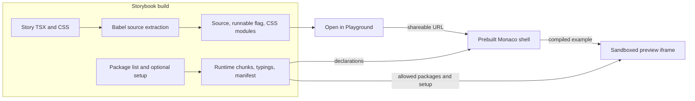

# @fluentui/react-storybook-addon-playground

**Configurable Storybook TSX playground for [Fluent UI React](https://developer.microsoft.com/en-us/fluentui)**

This addon serves a prebuilt Monaco playground shell and adds an **Open in Playground** button next to "Show code" in
Storybook Docs mode. The consumer's Storybook Webpack build produces a separate runtime for React, configured packages,
an optional setup module, and Monaco declarations. User code runs inside a sandboxed preview iframe.



The shell is built and published with the addon. Each consuming Storybook builds its own runtime from its configured
package resolution; the browser never installs packages or fetches code from a runtime CDN. See the
[specification and proposed follow-ups](docs/Spec.md) for the source pipeline, runtime boundaries, and roadmap.

## Features

- Consumer-controlled package list or import map (`options.modules`) compiled by Storybook Webpack and loaded on demand
  in production
- Private registry and workspace packages without a runtime CDN
- Build-time declaration collection for Monaco IntelliSense (from `modules` + optional `typings`), split per module and
  fetched when the code imports it
- Optional TSX `setup` module for branding, themes and provider/render behavior (Fluent defaults when omitted)
- Sandboxed preview (`sandbox="allow-scripts"`), Prettier formatting, error reporting and shareable URL state
- Live preview updates reuse the sandbox and loaded packages, with an explicit restart for a clean environment
- Console panel, type-error count, CSS module tabs you can add and remove, and preview width presets
- Compile errors link to their line in the editor; either pane can be maximized; `Cmd/Ctrl+S` formats the code and
  writes it to the link in the address bar; the active file can be copied from the editor header

## Installation

```sh
yarn add @fluentui/react-storybook-addon-playground
```

The optional `typescript` peer used for declaration parsing must be version 5.0 or newer. The editor itself uses the
TypeScript version bundled with its prebuilt Monaco shell.

Use the Webpack 5 Storybook builder and matching versions of `@storybook/react` and `@storybook/addon-docs`
(9.1.17 or newer, including Storybook 10).

## Usage

```js
// .storybook/main.js
const path = require('path');

module.exports = {
  addons: [
    {
      name: '@fluentui/react-storybook-addon-playground',
      options: {
        modules: ['@fluentui/react-components', '@fluentui/react-icons'],
        setup: path.resolve(__dirname, './playground.setup.tsx'), // optional
        // typings: ['@fluentui/react-theme'], // optional declaration-only entries
      },
    },
  ],
};
```

```js
// .storybook/preview.js
import '@fluentui/react-storybook-addon-playground/styles.css';
```

List packages in `modules` when their import names and resolved requests match. React runtime entries are provided
automatically, so they do not need to be listed. `typings` adds declaration-only entries without making them importable.

Use an import map only when an editor import should resolve to a different package or local module:

```js
options: {
  modules: {
    '@fluentui/react-components': '@fluentui/react-components',
    '@fluentui/react-icons': path.resolve(__dirname, './playground-icons.ts'),
  },
}
```

For example, `playground-icons.ts` can re-export only the icons your stories need. This keeps the public
`@fluentui/react-icons` import in examples without exposing the whole icon namespace to the playground.

Production builds load configured modules only when the example imports them. Development includes the modules in eager
chunks, but defers their evaluation until imported, avoiding Storybook's separate-origin lazy-compilation server.
Setup imports and React are always loaded at startup.
Typings load independently and do not block the first preview. React and `typings` declarations always load; each
configured module's declarations are a separate file fetched once the code imports that module, so examples that do not
use `@fluentui/react-icons` skip its large declarations. Declaration collection excludes JavaScript implementations,
falls back to `@types` packages when a runtime package does not ship declarations, and parses imports with the
project's `typescript` (an optional peer; a regular-expression parser is used without it).

### Workspace packages and declaration roots

Declaration collection uses the **final Storybook Webpack compiler's resolution**, including `resolve.alias`,
`resolve.modules`, dependency-specific resolution options and asynchronous resolver plugins. Aliases added by the
consumer's `webpackFinal` are honored. The collector locates the package metadata owning the resolved entry, then follows
its `types`/`typings`, typed `exports`, `typesVersions` and transitive declarations. Built output may live in `lib` while
declarations live in `dist`; workspace packages do not need a self-link under `node_modules`.

For example, a library's `.storybook/main.js` can resolve its public package import to built output:

```js
const path = require('path');

module.exports = {
  addons: [
    {
      name: '@fluentui/react-storybook-addon-playground',
      options: { modules: ['@workspace/ui'] },
    },
  ],
  webpackFinal(config) {
    config.resolve ??= {};
    config.resolve.alias = {
      ...config.resolve.alias,
      '@workspace/ui$': path.resolve(__dirname, '../lib'),
    };
    return config;
  },
};
```

Both the runtime and editor declarations resolve from that workspace package. Examples keep importing `@workspace/ui`,
even when Webpack resolves a package with a different physical name. Import maps likewise retain their public keys,
including maps to absolute runtime entry files.

When several exports share one JavaScript target, the requested export's declarations take precedence: exact keys
win over wildcard keys, and more specific wildcard prefixes/suffixes win regardless of key order. Remapped
aliases still follow the resolved target. Conditional exports honor Webpack's effective dependency-specific conditions
and export-map order. When a matched export has no `types` target, declarations beside its resolved JavaScript file
(including `typesVersions`) take precedence over generic package metadata. Packages using `main`/`module` without an
export map still use their declaration metadata. The collector preserves physical declaration contents and routes public
imports through separate virtual entries and package metadata, including `.d.mts` and `.d.cts` declarations.

If a local wrapper or nonstandard build layout needs declarations from a different package root, use
`options.typingsRoots`. Keys are **public Playground import names**, or declaration-only `typings` entries; values are
directories containing the package's `package.json` and declaration tree. Relative roots are resolved from the
Storybook config directory:

```js
options: {
  modules: {
    '@workspace/ui': path.resolve(__dirname, './playground-ui.mjs'),
  },
  typingsRoots: {
    '@workspace/ui': '..', // package.json alongside lib/ and dist/
  },
  // typings: ['declaration-only-package'],
  // typingsRoots can also specify that declaration-only package's root.
}
```

`typingsRoots` changes only declaration collection, not Webpack's runtime imports. The selected declarations must
describe the corresponding configured runtime module. Invalid roots fail the build; missing declarations produce a
Webpack warning with this option as a recovery path. Ordinary `node_modules` packages and `@types` fallbacks continue
to work. Yarn Plug'n'Play uses Webpack's resolver for workspace packages and archived transitive declarations without
a `node_modules` tree. Declaration-only entries remain non-importable at runtime. Collected declarations and package
metadata are watched and recollected when they change.

The addon reads its options from Storybook's preset options, generates its runtime entry in
`node_modules/.cache/fluentui-playground-runtime/` (next to the Storybook config), or the config directory's `.cache`
when there is no `node_modules`, and keeps the runtime out of Storybook pages through `html-webpack-plugin` hooks.
Monaco 0.52 with TypeScript 5.4 and Prettier are root build-time dependencies,
bundled into the prebuilt shell and not installed with the addon. PostCSS supports both the shell's CSS parsing and the
addon's build-time extracted CSS inlining. Declarations are collected for the TypeScript version bundled with Monaco,
so packages with `typesVersions` resolve the matching declaration tree.

Configuring the full `@fluentui/react-icons` package still bundles its whole namespace into an on-demand runtime chunk;
lazy loading avoids loading it for examples that do not import icons, but does not split individual icons. Per-icon
chunking is a [documented follow-up](docs/Spec.md#deferred), not part of the initial implementation.

### Live preview updates

The preview keeps its opaque-origin sandbox and loaded packages between edits. Updates run after a 150 ms pause.
TypeScript output is cached by editor model version, and unchanged CSS modules are not recompiled. Shared playground
links use the same live-update behavior.

- JavaScript edits remount the example component and reset its React state. This is runtime reuse, not React Fast Refresh.
- CSS declaration edits use stable file-scoped class names and update the existing component without resetting its state.
  Adding or removing local class names reevaluates the example so its imported class map remains accurate.
- Theme changes reuse the component; a custom setup's render tree can still cause a remount.
- **Run** explicitly reevaluates and remounts the example. **Restart preview** creates a clean sandbox without changing the
  editor code.
- Timers (`setTimeout`, `setInterval`, `requestAnimationFrame`) and `window`/`document` listeners created while the
  example module is evaluated are disposed when a newer version renders. React effect cleanup runs when the component
  unmounts. Other global mutations, and timers or listeners created later (for example inside callbacks), may remain;
  use Restart preview when debugging lifecycle behavior or whenever a clean environment is needed.
- Syntax/import/module-evaluation errors leave the previous preview visible. A component render error can clear the live
  preview; the next valid edit renders again, and Restart preview is available to reset a broken environment.

The sandbox remains `allow-scripts` only; live updates never add `allow-same-origin`.

### Deployment resource policies

The preview's `about:srcdoc` document has an opaque origin. Direct script requests can be blocked by
`Cross-Origin-Resource-Policy: same-origin`, including deployments using `Cross-Origin-Embedder-Policy: require-corp`.
The opaque iframe also cannot use the shell's HttpOnly `SameSite=Lax` authentication cookies for those requests.
This can affect both initial files such as `runtime~playground-runtime.*.js` and lazily loaded module chunks.

For same-origin runtime JavaScript, the addon avoids those requests: the build manifest's `allowedScriptFiles`
authorizes shell fetches for all eager and lazy runtime JavaScript files, while `scripts` lists startup files in order.
The shell fetches their text from its own origin, and execution remains entirely inside the sandbox.
Lazy chunks still load only when imported. Shared Webpack chunks retain their normal loader on Storybook pages.
No `allow-same-origin`, global `Cross-Origin-Resource-Policy: cross-origin` header, or consumer script loader is needed.

Only exact, canonical JavaScript URLs listed in the manifest **within the selected Storybook build root** can be
fetched through this channel. The manifest must be at `playground/runtime/manifest.json`, return JSON and have the
expected shape; asset paths outside that build, traversal/ambiguous encoded paths and query/hash variants are rejected.
Requests are authenticated by the preview window and session token. Fetches use same-origin credentials and
`redirect: 'error'`; non-success responses, login pages, JSON, plain text and missing or unsupported JavaScript content
types report an initialization error rather than navigating the iframe to sign-in. Disposing the preview aborts
pending fetches. The shell never evaluates returned JavaScript.

**Authentication of `playground.html` itself is a prerequisite.** The host must authenticate the user before serving
the shell and provide a session usable for its same-origin asset requests; the addon does not implement login or
bypass the host's authorization. Coverage uses a synthetic cookie-gated CORP deployment, with and without COEP,
not a hosted EasyAuth integration.

#### Private extracted CSS and fonts

For private builds with extracted stylesheets and protected font/image assets, enable build-scoped inlining:

```js
options: {
  modules: ['@workspace/ui'],
  inlineStyles: true,
}
```

Use production CSS extraction (tested with `mini-css-extract-plugin`), `css-loader` to resolve imports and URLs, and
Webpack `asset/resource` for fonts/images. The relevant Webpack settings are:

```js
const MiniCssExtractPlugin = require('mini-css-extract-plugin');

// Merge these settings into your existing production build, replacing its CSS loader pipeline, not adding a second one.
const cssBuildSettings = {
  module: {
    rules: [
      { test: /\.css$/, sideEffects: true, use: [MiniCssExtractPlugin.loader, 'css-loader'] },
      { test: /\.(woff2?|ttf|otf|eot|png|jpe?g|gif|svg|webp|avif|ico)$/i, type: 'asset/resource' },
    ],
  },
  plugins: [new MiniCssExtractPlugin({ filename: 'styles/[name].[contenthash].css' })],
};
```

Keep the CSS rule's `sideEffects: true` so stylesheet imports survive production tree-shaking even when their owning
package marks JavaScript as side-effect-free.

The inlining helper and its CSS parsers load only when `inlineStyles` is enabled; the parsers remain addon dependencies.
With this option, the manifest contains all extracted runtime CSS, including lazy CSS. Build-owned font/image
`url(...)` references are resolved relative to each emitted stylesheet and replaced with data URLs. `image-set()`
string URLs are handled too. Only this compilation's emitted assets are read: the build never fetches remote URLs
or arbitrary files. Missing assets, unsupported asset types and unresolved `@import` rules fail the build rather than
leaving a private resource request to fail in the iframe. Static directory/CDN URLs must be emitted through the
build's CSS pipeline instead; already-inline data URLs and local fragments remain valid.

The opaque preview installs those styles before executing the runtime, preserving Webpack's eager stylesheet order
and appending referenced lazy styles. Build-relative `data-href` attributes let the lazy CSS loader reuse them with
automatic, empty or explicit public paths. **This is an opt-in compatibility tradeoff, not transparent lazy CSS loading:**
lazy styles can change the cascade before their modules are imported, and all referenced CSS and embedded font/image
bytes transfer up front, including assets for unused modules. Opt in only when this ordering and initial transfer cost
are appropriate. Fonts load from data URLs without CORS or authentication requests from the iframe.
Storybook's original emitted CSS/font assets and native loaders remain unchanged. No general-purpose authenticated
fetch API, `allow-same-origin`, or permissive shared-server headers are added.

Rebuild and deploy **both the addon shell and the consuming Storybook runtime** together. Older manifests without
`allowedScriptFiles` retain direct script loading and therefore still need appropriate hosting permissions. Without
`inlineStyles`, extracted stylesheets/fonts still make native requests. Runtime-injected CSS (including `style-loader`
and CSS-in-JS font URLs), images and media not emitted through extracted CSS remain subject to their own resource
policies; use the supported extraction configuration for protected fonts. When using COEP, serve Monaco's worker
scripts with a compatible COEP response header as well; otherwise the browser can block editor workers.

### Preview sandbox

- The preview is an opaque-origin `srcdoc` iframe with `sandbox="allow-scripts"`. Messages to the shell target the
  shell's origin; messages from the shell are authenticated by source window and a per-sandbox token.
- A Content Security Policy only allows scripts, styles, fonts and network requests from the origins that serve the
  Storybook runtime. `fetch`/XHR/WebSocket to other origins, nested frames and form submissions are blocked. Images and
  media can load from any HTTPS URL.
- `console.*` output is forwarded to the **Console** panel below the preview (rate limited to 100 messages per second).
  It is cleared whenever the example remounts, on **Run** and on **Restart preview**.

### Shared links

Links store the code and CSS modules in the URL hash (`#code=…&css=…&title=…&v=1`), compressed with lz-string. `v` is
the format version; links without it are read as version 1. The optional `title` names the example (the **Open in
Playground** button sets it to `Component: Story`) and is shown in the header and the browser tab. Payloads longer than
200,000 characters are rejected, and decoding stops once the code or styles would exceed 1,000,000 characters, so a
small crafted link cannot expand into a huge document. The playground warns when a link cannot be fully read (for
example when a chat app truncated it) and when **Copy link** produces a URL longer than 8,000 characters.
`readPlaygroundHash` exposes the same parser for tools that create or inspect links.

The normally mounted `playground/app/playground.html` shell loads `../runtime/manifest.json` and is bound to that
Storybook build. An override may name the same manifest, not a different same-origin build or arbitrary JSON endpoint.
A standalone shell mounted outside that standard path can explicitly select a same-origin build, for example
`/standalone/playground.html?manifest=/storybook/playground/runtime/manifest.json`. Its manifest must still be at the
standard emitted location, and all manifest assets are confined to `/storybook/`. Invalid overrides fail visibly.

The optional setup module default-exports a value created with `definePlaygroundSetup`:

```tsx
import * as React from 'react';
import { FluentProvider, webLightTheme } from '@fluentui/react-components';
import { definePlaygroundSetup } from '@fluentui/react-storybook-addon-playground/setup';

export default definePlaygroundSetup({
  title: 'Fluent UI Playground',
  defaultCode: `import { Button } from '@fluentui/react-components';

export default () => <Button>Hello</Button>;`,
  themes: [{ id: 'web-light', label: 'Web Light', value: webLightTheme }],
  render: ({ Component, theme }) => (
    <FluentProvider theme={theme ?? webLightTheme}>
      <Component />
    </FluentProvider>
  ),
});
```

When `setup` is omitted, the addon's built-in Fluent UI default setup is used.

### Story source

The button reads the story source from `parameters.fullSource`, which is injected at build time by
`@fluentui/babel-preset-storybook-full-source` (registered by `@fluentui/react-storybook-addon-export-to-sandbox`).
Other consumers can populate the same parameter with their own Storybook source transform. The button is not rendered
when `parameters.fullSource` is unavailable, `parameters.fullSourceIsRunnable` is `false`, or the story imports a
package that is not listed in `options.modules` (type-only imports are ignored). The runnable flag describes source
extraction completeness, not package availability; the addon checks the allowlist separately.

`parameters.fullSourceUnsupportedImports` retains diagnostic specifiers and is also checked for compatibility with
older transforms. Legacy or third-party source without the runnable flag remains supported. A non-runnable source
string is still available for Docs source display.

CSS module tabs are enabled by the source transform's `cssModules` option: the transform preserves CSS imports and
attaches `parameters.cssModuleSources`, which the playground passes through its URL state into the editor. The
export-to-sandbox addon currently registers that shared Babel transform; it is not the playground's execution engine.
Separating source extraction from external sandbox export is a [proposed architectural follow-up](docs/Spec.md#follow-ups).

### Docs source actions

On Storybook Docs versions that support `parameters.docs.components.Canvas` overrides, the addon composes the public
Canvas block and supplies its button through
[`additionalActions`](https://storybook.js.org/docs/api/doc-blocks/doc-block-canvas#additionalactions). Storybook owns
the action's rendering and placement alongside Show/Hide code and Copy code. Existing Canvas actions and source controls
are preserved, and the decorator does not clone, move or replace these React-owned buttons.

Supported earlier Docs versions that do not honor Canvas overrides use a compatibility fallback inside the addon.
It locates the source controls under the story's Docs anchor, covering both the earlier `.docs-story` action area and
Storybook 10's separate `.sbdocs-preview-actions` row, including primary-story anchors. The button inherits the source
control's Storybook classes. No consumer decorator, DOM relocation shim or custom Docs page is required.

A consumer-supplied Canvas override takes precedence over the addon's override. The decorator fallback still works
when that custom block retains the standard Storybook source controls and story anchors.

### Disabling per story

```ts
export const MyStory = () => <Button />;
MyStory.parameters = { playground: { disable: true } };
```

## Development (monorepo)

The playground **shell** is a separate webpack bundle (Monaco + UI). The repository Storybooks load the addon's compiled
preset and preview code, not an in-memory TypeScript preset. Build the addon and shell together before loading it:

```sh
yarn nx run react-storybook-addon-playground:build
```

The v9 docsite's Storybook build and development targets use Nx's `^build` dependency graph to prepare the addon,
runtime packages, and declarations. Start it through Nx so those prerequisites are honored:

```sh
yarn nx run public-docsite-v9:start
```

Story source still uses the docsite's normal TypeScript path aliases; those aliases are not used to load the addon.

The **runtime** (configured modules, setup, typings, `manifest.json`) is emitted by Storybook's Webpack build into
`playground/runtime/`. The shell is served at `playground/app/playground.html`.

Browser tests (Playwright) build a small fixture runtime with the addon's real `webpackFinal` hook, serve it next to the
prebuilt shell and cover the default setup, shared links, live CSS/theme updates, error recovery, Restart, lazy
modules, the console panel and CSP, type-error count, CSS module management and preview widths:

```sh
yarn nx run react-storybook-addon-playground:e2e
```

## Limitations

- Only configured packages, the built-in React entries, and CSS modules can be imported. CSS modules shipped with a
  story (via `parameters.cssModuleSources`) or added with the **+** button appear as editor tabs, compile on edit, and
  are injected into the sandbox as hashed class maps plus a `<style>` tag. Other relative imports are not supported.
- Type errors are shown in the editor and counted in the editor header, but do not block running the code.
